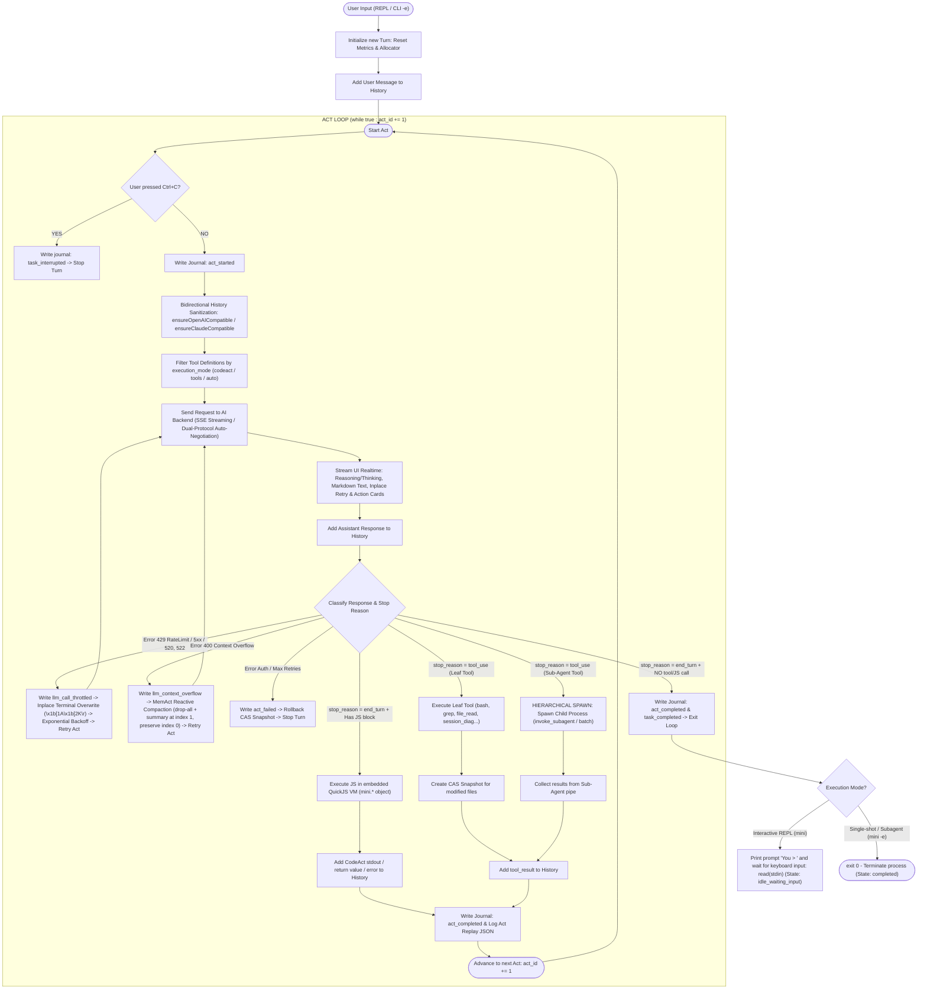
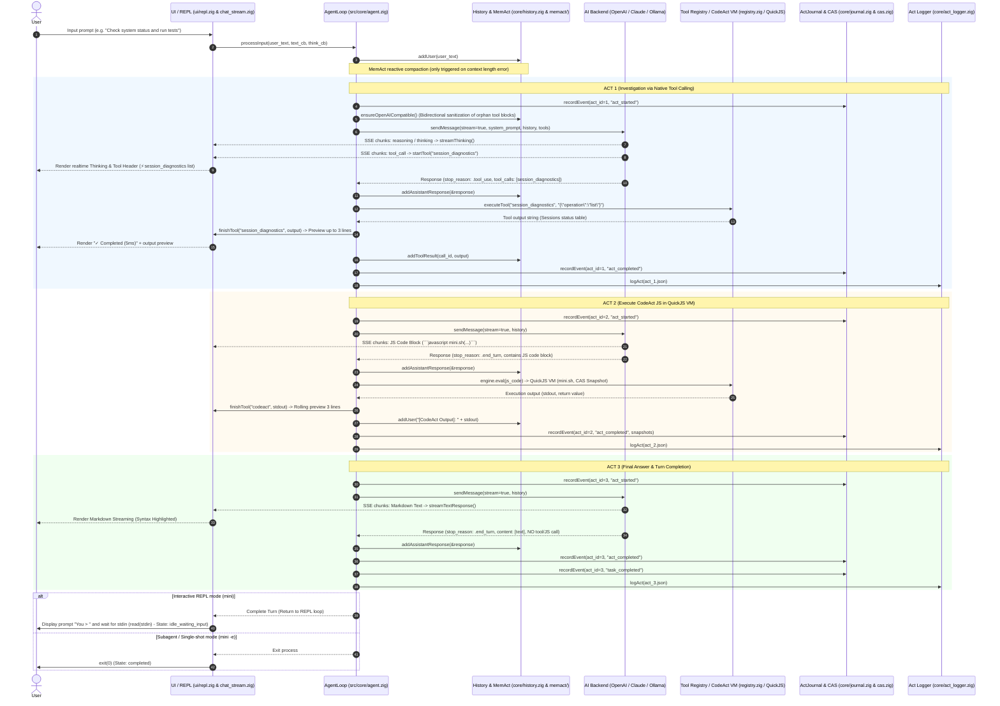
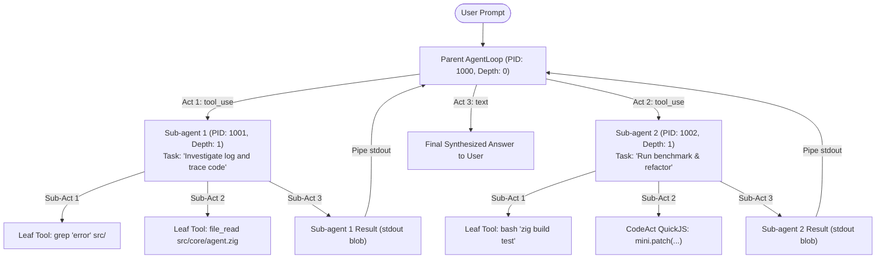
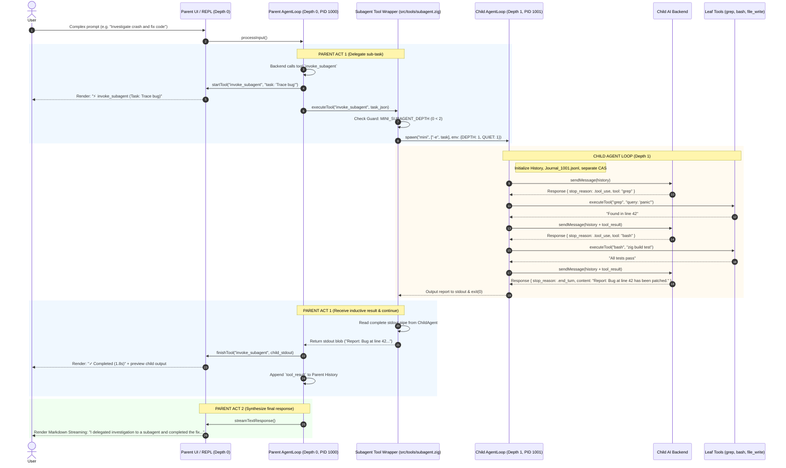

# Agent Loop Execution Architecture

This document details and visualizes the complete execution flow of **1 Agent Loop (1 Turn / Multi-Act Loop)** in `mini-agent` — from receiving a User Prompt, multi-tier resolution, single tool execution to the **Hierarchical / Recursive Sub-agent Execution Tree**.

---

## 1. End-to-End Execution Flowchart

---

## 2. Single-Level Sequence Diagram

---

## 3. Recursive / Inductive Sub-Agent Tree

A tool such as `invoke_subagent` or `batch_invoke_subagents` **is not a leaf tool**, but an **intermediate Subtree Generator node**. Each subagent spawns an independent process and executes a complete recursive `AgentLoop`.

### A. Execution Tree

---

### B. Inductive Recursive Sequence Diagram

---

## 4. Stream Aggregation & Isolation

| Aspect | Parent Process (Depth $d$) | Child Process (Subagent - Depth $d+1$) |
|---|---|---|
| **PID & Process** | Runs interactive REPL or primary CLI. | Independent subprocess spawned via `std.process.spawn`. |
| **History & Context** | Manages main user conversation. | Local context serving assigned `task` only. |
| **Event Sourcing Journal** | `~/.mini/sessions/journal_<parent_pid>.jsonl` | Independent `~/.mini/sessions/journal_<child_pid>.jsonl`. |
| **Telemetry & State** | `executing_act` $\to$ `idle_waiting_input`. | `executing_act` $\to$ `completed` (exit 0). |
| **Stream UI & Output** | Renders directly to Terminal (Thinking, Tools, Markdown). | `stdout`/`stderr` redirected to Pipe; startup banner suppressed (`QUIET=1`). Final output rolled up into Parent `tool_result`. |
| **Depth Guard** | Verifies `depth < max_depth` (default $\le 2$). | Automatically increments `MINI_SUBAGENT_DEPTH = d + 1`. Prevents recursive fork bomb. |

---

## 5. Loop States & Telemetry Meanings

When inspecting processes via `session_diagnostics` or journal file `~/.mini/sessions/journal_<pid>.jsonl`, process states are precisely defined as:

| State | Last Event | OS State | Operational Meaning |
|---|---|---|---|
| `idle_waiting_input` | `task_completed` | `ALIVE` (`anon_pipe_read`) | **REPL process is idle**, turn finished, waiting for user keyboard input at `You > ` prompt. |
| `executing_act` | `act_started` | `ALIVE` | Sending request to LLM backend (waiting for stream) or executing Tool / Sub-agent. |
| `between_acts` | `act_completed` | `ALIVE` | Just completed an Act, transitioning context to next Act. |
| `completed` | `task_completed` | `DEAD` (Exit 0) | Subagent or single-shot `-e` process completed all work and exited cleanly. |
| `crashed` / `failed`| `act_failed` | `DEAD` / `ALIVE` | Encountered terminal error (auth failure, network crash, unrecoverable syntax error). |

---

## 6. Resilience & Safety Guards

1. **Subagent Depth Guard (`src/tools/subagent.zig`)**:
   - Verifies `MINI_SUBAGENT_DEPTH <= MINI_MAX_SUBAGENT_DEPTH` (default = 2).
   - Prevents infinite recursion or fork bombs when a subagent calls itself.
2. **CAS State Snapshot & Rollback (`src/core/snapshot.zig` + `cas.zig`)**:
   - Before overwriting files (`file_write`, `file_edit`, `mini.write`, `mini.patch`), previous contents are SHA-256 hashed and stored in Content-Addressed Storage (`~/.mini/cas/`).
   - If an Act fails terminally or the user requests rollback, files are restored to their exact original state.
3. **MemAct Compaction (`src/core/history.zig`)**:
   - Automatically compacts context when token threshold is exceeded without losing initial System Prompt or User Intent.
4. **Tool Argument Sanitizer (`src/backends/openai.zig`)**:
   - Automatically unescapes JSON arguments from Responses API SSE streams to guarantee tools receive clean JSON objects without double-escaped `\"`.

