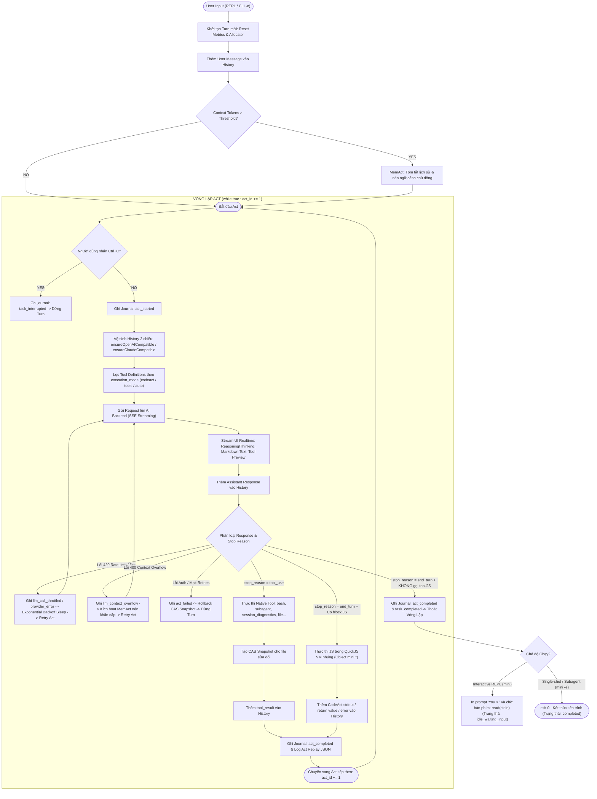
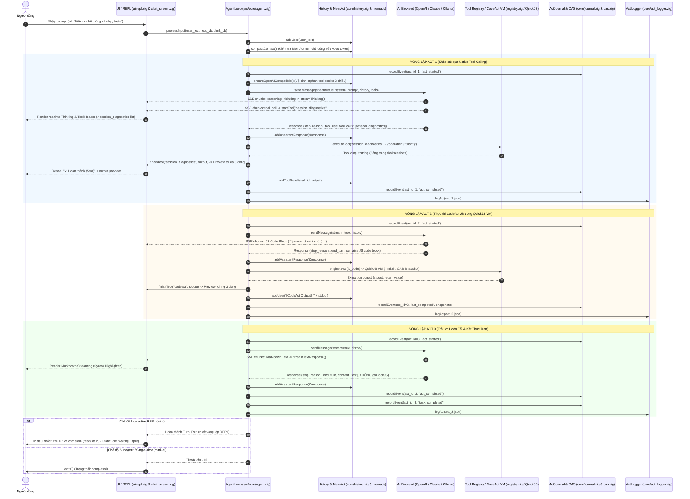

# Kiến Trúc Vòng Lặp Xử Lý Của Agent (Agent Loop Execution Architecture)

Tài liệu này mô tả chi tiết và trực quan toàn bộ luồng thực thi của **1 Vòng lặp Agent (1 Turn / Multi-Act Loop)** trong `mini-agent` — từ lúc tiếp nhận User Prompt cho đến khi hoàn thành nhiệm vụ và quay về trạng thái nhàn rỗi (REPL Idle) hoặc thoát tiến trình.

---

## 1. Sơ đồ Luồng Tổng Thể (End-to-End Execution Flowchart)

---

## 2. Trình Tự Thực Thi Chi Tiết Từng Bước (Detailed Sequence Diagram)

---

## 3. Các Trạng Thái Vòng Lặp & Ý Nghĩa Telemetry

Khi kiểm tra tiến trình qua tool `session_diagnostics` hoặc file journal `~/.mini/sessions/journal_<pid>.jsonl`, trạng thái của tiến trình được định nghĩa chuẩn xác như sau:

| State | Event cuối | Trạng thái OS | Ý nghĩa nghiệp vụ |
|---|---|---|---|
| `idle_waiting_input` | `task_completed` | `ALIVE` (`anon_pipe_read`) | **Tiến trình REPL đang rảnh**, đã trả lời xong và đang đứng chờ người dùng gõ câu lệnh tiếp theo tại dấu nhắc `You > `. |
| `executing_act` | `act_started` | `ALIVE` | Đang gửi request lên LLM backend (chờ streaming) hoặc đang chạy Tool (bash, subagent...). |
| `between_acts` | `act_completed` | `ALIVE` | Vừa thực thi xong 1 Act, đang chuẩn bị chuyển ngữ cảnh sang Act tiếp theo. |
| `completed` | `task_completed` | `DEAD` (Exit 0) | Tiến trình subagent hoặc single-shot `-e` đã hoàn thành toàn bộ công việc và tự thoát an toàn. |
| `crashed` / `failed`| `act_failed` | `DEAD` / `ALIVE` | Gặp lỗi terminal (xác thực, sập mạng, syntax crash không thể retry). |

---

## 4. Các Chốt Chặn An Toàn & Khả Năng Tự Phục Hồi (Resilience & Guards)

1. **Subagent Depth Guard (`src/tools/subagent.zig`)**:
   - Kiểm tra `MINI_SUBAGENT_DEPTH <= MINI_MAX_SUBAGENT_DEPTH` (mặc định = 2).
   - Tự động chặn nguy cơ đệ quy vô hạn hoặc fork bomb khi subagent tự gọi chính nó.
2. **CAS State Snapshot & Rollback (`src/core/snapshot.zig` + `cas.zig`)**:
   - Trước khi ghi đè tệp (`file_write`, `file_edit`, `mini.write`, `mini.patch`), nội dung cũ được hash SHA-256 và lưu vào Content-Addressed Storage (`~/.mini/cas/`).
   - Nếu Act bị lỗi terminal hoặc người dùng yêu cầu rollback, hệ thống khôi phục nguyên trạng tệp gốc.
3. **MemAct Compaction (`src/core/history.zig`)**:
   - Tự động nén ngữ cảnh khi token vượt ngưỡng mà không làm mất System Prompt hay User Intent ban đầu.
4. **Tool Argument Sanitizer (`src/backends/openai.zig`)**:
   - Tự động unescape JSON arguments từ SSE stream Responses API để đảm bảo tool luôn nhận đúng đối tượng JSON thuần không bị double-escape `\"`.
