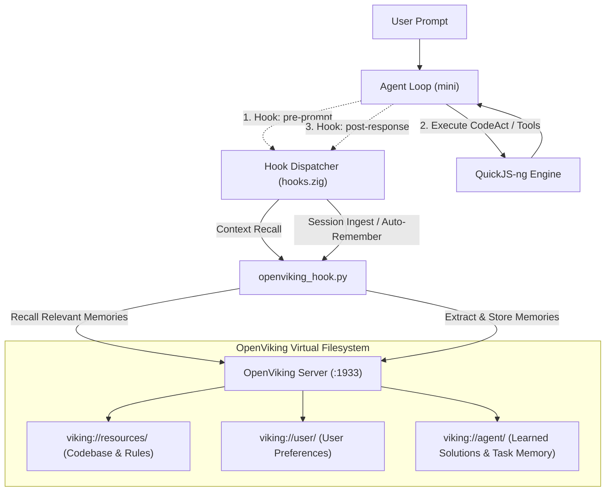

# PROPOSAL: QUICKJS-NG EMBEDDED CODE-CENTRIC AGENT ARCHITECTURE CHO MINI
> **Document**: RFC-001 (Revision 7 — Long-Lived Tasks & Lifecycle Context Tracking)  
> **Status**: Approved / In Implementation  
> **Target System**: `mini-agent` (`mini`)  
> **Core Interpreter**: **Embedded QuickJS-ng (ES2023/ES2024 Modern JavaScript Runtime)**  
> **Repository**: [quickjs-ng/quickjs](https://github.com/quickjs-ng/quickjs)  
> **Author**: Core Team & AI Pair Programmer  
> **Date**: 20/08/2026  

---

## 1. TỔNG QUAN & BỐI CẢNH (EXECUTIVE SUMMARY)

### 1.1. Hiện trạng: Hạn chế của JSON Tool-Calling (RPC-style)
Kiến trúc ban đầu của `mini` dựa trên chuẩn **JSON Tool-Calling** truyền thống (Function Calling / RPC):
1. Agent nhận yêu cầu của người dùng, phân tích và sinh ra cấu trúc JSON (`tool_use`).
2. Tiến trình `mini` parse JSON, dispatch đến handler tương ứng (ví dụ: `grep`, `file_read`, `file_edit`), rồi gửi kết quả (`tool_result`) ngược lại cho LLM.
3. LLM phân tích kết quả và tiếp tục vòng lặp.

#### Các điểm nghẽn nghiêm trọng trong thực tế:
- **Độ trễ cao (High Turn Latency)**: Mỗi thao tác đơn lẻ tốn 1 roundtrip mạng đến AI Provider. Một tác vụ thông thường (tìm file → đọc file → sửa lỗi → chạy test) đòi hỏi từ **5 đến 10 LLM turns** (mỗi turn mất 3-8 giây).
- **Ô nhiễm cửa sổ ngữ cảnh (Context Bloating)**: Các kết quả trung gian chưa qua chọn lọc (như output 200 dòng của `grep` hay toàn bộ nội dung file 1,000 dòng) bị đẩy trực tiếp vào context window, làm cạn kiệt token và tăng chi phí.
- **Không có cấu trúc điều khiển (No Control Flow)**: LLM không thể viết vòng lặp `for`, rẽ nhánh `if/else`, pipe `|` dữ liệu giữa các công cụ trong cùng một bước mà phải chờ LLM turn tiếp theo.
- **Mất ngữ cảnh dài hạn & Khó khăn với tác vụ dài**: Lịch sử chỉ lưu in-memory ngắn hạn (bị compact sau 40 message) và không có cơ chế quản lý các tiến trình chạy ngầm (dev servers, test watchers, long builds).

---

### 1.2. Giải pháp: QuickJS-ng Code-Centric + Multi-Tier Execution + Context Hooks
Chuyển đổi cơ chế tương tác công cụ của `mini` sang mô hình toàn diện:
- **QuickJS-ng Engine được nhúng trực tiếp (In-Process VM)** vào binary của `mini` — zero external dependency, ~200-300KB static link.
- Toàn bộ công cụ của `mini` (`fs`, `grep`, `glob`, `http`, `sh`, `artifact`) được export thành **in-process C-ABI bindings** trong object toàn cục **`mini.*`**.
- **Chiến lược Xử lý Tác vụ Chạy Dài (OpenHands Pattern)**: Cung cấp API chạy nền (`mini.shBackground`), quản lý vòng đời tiến trình qua Job ID, stream output theo thời gian thực và tự động cắt tỉa output buffer.
- **Tự động Theo dõi Ngữ cảnh & Bộ nhớ Dài hạn (OpenViking Hook Pattern)**: Sử dụng hệ thống **Lifecycle Hooks** (`hooks.zig`) để tự động ghi log phiên, trích xuất memory và đồng bộ với OpenViking Context Database mà không tiêu tốn token gọi tool của LLM.
- **Hệ thống Kiểm soát Thực thi Đa Tầng (Multi-Tier Execution Control)**: Tách biệt hoàn toàn giữa việc ngăn chặn CPU Infinite Loop trong JS thuần và việc hỗ trợ các tác vụ chạy dài hợp lệ (Long I/O / Subprocesses / Background Daemons).

---

## 2. TẠI SAO CHỌN QUICKJS-NG (NEXT GENERATION)?

### 2.1. Phân tích so sánh: QuickJS-ng vs QuickJS gốc (Bellard) vs LuaJIT

Quyết định chọn **QuickJS-ng** dựa trên đánh giá toàn diện kỹ thuật và thực tiễn:

| Khía cạnh | QuickJS-ng (Được chọn ⭐) | QuickJS Gốc (Bellard) | Lua / LuaJIT |
|:---|:---|:---|:---|
| **Chuẩn ECMAScript** | **ES2023 + ES2024 Stage 4** (Set methods, Iterator Helpers, Promise.try, Float16Array) | ES2020 / ES2023 hạn chế | Không áp dụng (Lua 5.1/5.2 syntax) |
| **Bảo trì & Phát triển** | **Cộng đồng năng động**, release ~2 tháng/lần, test262 per PR | Cá nhân (chậm cập nhật, ít PR) | Bị đóng băng ở Lua 5.1 ABI |
| **Debug & Stack Trace** | **Rất chi tiết**: V8-compatible `Error.captureStackTrace`, stack trace chính xác dòng/cột | Stack trace cơ bản | Cần debug module / pcall thủ công |
| **Độ chính xác sinh mã (LLM)** | **Top-2 (~80-88% Pass@1)** — Gần bằng Python | ~80-88% Pass@1 | ~45-60% Pass@1 (LLM hay nhầm cú pháp) |
| **Sandbox & Resource Limit** | **Native C API**: `JS_SetMemoryLimit`, `JS_SetInterruptHandler`, `JS_SetMaxStackSize` | Native C API tương tự | Phải tắt JIT + custom allocator + thread kill |
| **Tương thích Build Zig** | **Hoàn hảo** (CMake / `zig-quickjs-ng` / direct static compile) | Tốt nhưng cần patch Makefile | Phức tạp (`zig-luajit-build`) |
| **Tính an toàn bộ nhớ** | Vá liên tục các lỗi parser, memory leaks, CVEs | Còn tồn đọng một số edge-case bugs | Nguy cơ FFI bypass sandbox |
| **Async / Promise** | Native async/await, Promise lifecycle, job queue | Native async/await | Phải tự xây coroutine / event loop |

---

### 2.2. Lợi thế kỹ thuật vượt trội của QuickJS-ng cho mini-agent

#### A. Khả năng sinh mã áp đảo từ LLM
LLM được huấn luyện trên hàng trăm tỷ dòng JavaScript hiện đại (GitHub, npm, MDN, StackOverflow). LLM hiểu sâu các cấu trúc:
- Destructuring: `const { ok, message } = mini.patch(...)`
- Array methods: `.map()`, `.filter()`, `.find()`, `.some()`, `.every()`
- Modern control flow: `for...of`, `try...catch...finally`, `async/await`
- Optional chaining `?.` và Nullish coalescing `??`

#### B. Stack Trace chuẩn xác phục vụ Self-Correction Loop
QuickJS-ng cung cấp cơ chế stack trace mạnh mẽ, hiển thị rõ vị trí lỗi `<eval>:line:col`. Điều này cho phép `mini` đóng gói context lỗi chuẩn xác để LLM tự sửa mã ngay lập tức:
```
[JS ERROR] TypeError: mini.grpe is not a function
    at runScript (<eval>:14:18)
    at <eval>:25:1
```

---

## 3. CHIẾN LƯỢC HYBRID: JS CODEACT + JSON TOOL FALLBACK

Proposal này **KHÔNG** xóa bỏ hệ thống JSON tool-calling hiện tại. Thay vào đó, áp dụng kiến trúc **Hybrid hai tầng**:

```
                         ┌──────────────────────────────────────┐
                         │       Agent Loop (agent_loop.zig)    │
                         └──────────────┬───────────────────────┘
                                         │
                    ┌───────────────────┴───────────────────┐
                    │                                       │
          [Ưu tiên: JS CodeAct]               [Fallback: JSON Tool-Calling]
          - Model mạnh (Claude 3.7,           - Model nhỏ/yếu (phi-3,
            GPT-4o, Gemini 2.5, DeepSeek)       llama-3, local Ollama)
          - System Prompt chứa                - Giữ nguyên JSON schema
            mini.* API + ví dụ JS               tools hiện tại
          - Code block extraction             - Không yêu cầu thay đổi
            từ markdown ```js```                model behavior
```

### Cơ chế chuyển đổi (Execution Mode):
- **`execution_mode = "codeact"` (Mặc định cho cloud LLMs)**: LLM sinh JavaScript hiện đại, chạy qua QuickJS-ng VM.
- **`execution_mode = "tools"` (Dành cho local/small LLMs)**: Giữ nguyên JSON tool-calling truyền thống.
- **`execution_mode = "auto"`**: `mini` tự động chọn mode dựa trên model name / metadata backend.

---

## 4. THIẾT KẾ KIẾN TRÚC MÃ NGUỒN (TARGET CODEBASE ARCHITECTURE)

```
src/
├── main.zig                # Composition root, CLI args parser & REPL loop
├── core/                   # Điều phối & Quản lý trạng thái
│   ├── agent_loop.zig      # Hybrid Loop (JS CodeAct ↔ JSON Tools, Self-Correction)
│   ├── permissions.zig     # Dynamic Security (Ask / Auto / Yolo)
│   ├── history.zig         # State compaction & History quản lý code executions
│   └── contracts.zig       # Interfaces, Event types & Token specs
├── runtime/                # Môi trường thực thi QuickJS-ng
│   ├── quickjs_engine.zig  # JSRuntime/JSContext management, sandbox, heartbeat watchdog
│   ├── js_bindings.zig     # C-ABI bindings: export toàn bộ Zig tools sang object `mini.*`
│   ├── process_manager.zig # Quản lý subprocesses, background jobs (OpenHands Pattern) & non-blocking I/O
│   └── shell_runner.zig    # Subprocess runner phục vụ `mini.sh(...)` & `mini.shStream(...)`
├── hooks/                  # Hệ thống Lifecycle Hooks & Context Tracking
│   ├── dispatcher.zig      # Phát sự kiện pre-prompt, post-response, pre/post-tool
│   └── openviking_hook.py  # Bridge tự động ingest session & context sang OpenViking DB
├── stdlib/                 # Core Tool Implementations (Native Zig)
│   ├── fs_tools.zig        # read, write, patch (diff/exact/regex), exists, stat
│   ├── search_tools.zig    # ripgrep, glob engine
│   ├── http_tools.zig      # HTTP client (sync & async streaming)
│   └── artifact_tools.zig  # Artifact management
├── backend/                # Multi-provider LLM transport (OpenAI, Claude, Ollama)
├── tools/                  # [GIỮ NGUYÊN] JSON Tool handlers cho fallback mode
└── ui/                     # Terminal rendering & Streaming think/code parser
```

---

## 5. ĐẶC TẢ API OBJECT `mini.*` TRONG QUICKJS-NG RUNTIME

Khi QuickJS-ng VM khởi tạo cho mỗi phiên chạy, môi trường được nạp sẵn object toàn cục **`mini`** với các API chuẩn hóa:

```javascript
// ===========================================================================
// ĐẶC TẢ API OBJECT mini (QuickJS-ng ES2023+ Runtime)
// ===========================================================================

// 1. Tìm kiếm & Quét thư mục
mini.glob(pattern, basePath?)              // → string[] (danh sách đường dẫn)
mini.grep(pattern, path?, options?)        // → Array<{ path: string, line: number, text: string }>

// 2. Thao tác Tệp & Thư mục
mini.read(path, offsetLine?, limitLines?)  // → string (nội dung tệp)
mini.write(path, content)                  // → { ok: boolean, message: string }
mini.patch(path, oldStr, newStr, opts?)    // → { ok: boolean, message: string }
  // opts (object, optional):
  //   occurrence: number   (mặc định 1: thay thế lần thứ N, 0 = tất cả)
  //   regex: boolean       (nếu true, oldStr là biểu thức chính quy)
  //   lineStart: number    (giới hạn tìm kiếm từ dòng này)
  //   lineEnd: number      (giới hạn tìm kiếm đến dòng này)
mini.exists(path)                          // → boolean
mini.stat(path)                            // → { size: number, isDir: boolean, isFile: boolean, modified: number }

// 3. Thực thi Lệnh Hệ thống (Shell & Process Management — OpenHands Pattern)
mini.sh(command, opts?)                    // → { exitCode: number, stdout: string, stderr: string, ok: boolean }
  // opts: { timeoutMs?: number (mặc định 30000), stdin?: string, cwd?: string }
mini.shStream(command, opts?)              // → number (exitCode)
  // Lệnh dài (build, test, migration). Stdout/Stderr stream real-time ra terminal.
  // opts: { timeoutMs?: number (0 = vô hạn / không giới hạn), cwd?: string }
mini.shBackground(command, opts?)          // → { jobId: string, pid: number, logPath: string }
  // Khởi chạy tiến trình chạy ngầm (dev server, watcher, test runner dài hạn)
mini.jobStatus(jobId)                      // → { running: boolean, exitCode?: number, pid: number }
mini.jobLogs(jobId, lines?: number)        // → string (đọc N dòng log gần nhất)
mini.jobKill(jobId, signal?: string)       // → boolean (dừng tiến trình ngầm)

// 4. HTTP & Mạng
mini.http(method, url, opts?)              // → { status: number, headers: Record<string, string>, body: string }
  // opts: { timeoutMs?: number (mặc định 60000), headers?: object, body?: string }

// 5. Artifacts & Ngữ cảnh Phiên
mini.artifact(name, content, metadata?)    // → string (đường dẫn artifact đã tạo)
mini.env(varName)                          // → string | null (lấy biến môi trường)
mini.workspaceRoot                         // → string (thư mục làm việc hiện tại)
mini.sessionId                             // → string (ID phiên làm việc)

// 6. Tác vụ Bất đồng bộ (ES2023 Async/Await — Giai đoạn 3+)
// await mini.httpAsync(method, url, opts?)
// await Promise.all([mini.httpAsync(...), mini.httpAsync(...)])
```

---

## 6. VÒNG LẶP TỰ SỬA LỖI (ERROR RECOVERY & SELF-CORRECTION LOOP)

Yếu tố cốt lõi của kiến trúc CodeAct là khả năng **tự debug và sửa lỗi (Self-Correction)** khi mã sinh ra gặp sự cố:

```
┌──────────────────────────────────────────────────────────────────────┐
│                     AGENT LOOP (1 User Request)                      │
│                                                                      │
│  [1] LLM sinh JavaScript code block                                  │
│       │                                                              │
│  [2] Extract code từ markdown ```js ... ```                          │
│       │                                                              │
│  [3] Chạy trong QuickJS-ng VM (Multi-Tier Execution & Sandbox)       │
│       │                                                              │
│       ├── SUCCESS (exit ok, có output)                               │
│       │     └── Output được format + truncate → Gửi về LLM          │
│       │         └── LLM phân tích kết quả → trả lời user HOẶC       │
│       │             sinh thêm JS code → quay lại [2]                 │
│       │                                                              │
│       └── ERROR (syntax error / runtime error / timeout)             │
│             │                                                        │
│         [4] Format error message từ QuickJS-ng:                      │
│             "[JS ERROR] TypeError: mini.grpe is not a function       │
│                  at runScript (<eval>:12:15)"                        │
│             + Stack trace đầy đủ                                     │
│             + Source code gốc đã sinh                                │
│             │                                                        │
│         [5] Gửi error context về LLM                                 │
│             │                                                        │
│         [6] LLM phân tích stack trace và sinh JS code sửa lỗi        │
│             │                                                        │
│         [7] Nếu retry >= MAX_JS_RETRIES (3):                         │
│             └── FALLBACK: Chuyển sang JSON tool-calling mode         │
│                 cho phần còn lại của request                         │
└──────────────────────────────────────────────────────────────────────┘
```

---

## 7. MÔ HÌNH BẢO MẬT & KIỂM SOÁT THỰC THI TÁC VỤ CHẠY DÀI (OPENHANDS PATTERN)

### 7.1. Phân tích vấn đề của cơ chế Timeout đơn giản (`JS_SetInterruptHandler` cố định 30s)

> [!CAUTION]
> **Vấn đề chí tử của mô hình Interrupt cố định theo Wall-Clock**:
> 1. **Chặn Syscall vs Bytecode**: Khi script gọi một lệnh dài như `mini.shStream("zig build test")` hay `mini.sh("npm install")`, luồng điều khiển chuyển sang native Zig code (blocking syscall hoặc waiting child process). QuickJS **hoàn toàn không thực thi bytecode** trong lúc đó. `JS_SetInterruptHandler` không thể ngắt các syscall đang bị treo này.
> 2. **Giết nhầm tác vụ dài hợp lệ**: Một tác vụ biên dịch hoặc chạy test hợp lệ có thể kéo dài 2-10 phút. Nếu đặt deadline cố định 30s wall-clock, ngay khi lệnh build 40s vừa hoàn tất và trả về JS bytecode, `JS_SetInterruptHandler` sẽ bị kích hoạt và **lập tức giết chết tiến trình JS**.
> 3. **Đóng băng khi chờ người dùng**: Khi agent hiển thị prompt phân quyền `permissions.zig: [y/N]`, nếu người dùng cần 45 giây để kiểm tra diff, deadline 30s sẽ làm script bị ngắt ngoài ý muốn.

---

### 7.2. Kiến trúc Kiểm soát Thực thi Đa Tầng (Multi-Tier Execution Architecture)

Để vừa bảo vệ chống vòng lặp vô hạn (Infinite Loops / CPU Starvation), vừa hỗ trợ trơn tru các tác vụ chạy dài (Long-Lived Tasks / Background Jobs), `mini` thiết kế hệ thống kiểm soát 5 tầng kế thừa ưu điểm từ OpenHands:

```
┌────────────────────────────────────────────────────────────────────────┐
│             HỆ THỐNG KIỂM SOÁT THỰC THI ĐA TẦNG CỦA MINI              │
├────────────────────────────────────────────────────────────────────────┤
│ Tầng 1: Heartbeat / Activity Watchdog (QuickJS-ng Level)               │
│   - Chỉ ngắt khi phát hiện CPU Starvation (ví dụ: while(true) {} > 5s) │
│   - Tự động reset bộ đếm (Heartbeat Renewal) mỗi khi có I/O hoặc Output│
├────────────────────────────────────────────────────────────────────────┤
│ Tầng 2: Native OS-Level Subprocess & Network Timeout (Zig Level)       │
│   - Timeout kiểm soát độc lập cho từng lệnh: mini.sh(cmd, {timeoutMs}) │
│   - mini.shStream mặc định timeoutMs = 0 (cho phép chạy dài hợp lệ)    │
│   - Quản lý qua Process Group (killpg) + POSIX SIGTERM / SIGKILL       │
├────────────────────────────────────────────────────────────────────────┤
│ Tầng 3: User Interaction Freeze (Permission Level)                     │
│   - Tạm dừng (PAUSE) toàn bộ watchdog khi chờ prompt xác nhận [y/N]    │
├────────────────────────────────────────────────────────────────────────┤
│ Tầng 4: User Manual Cancellation (Signal Level)                        │
│   - Bắt Ctrl+C (SIGINT): hủy đồng bộ cả Subprocess và QuickJS VM       │
├────────────────────────────────────────────────────────────────────────┤
│ Tầng 5: Background Task Manager & Log Inspection (OpenHands Pattern)   │
│   - Hỗ trợ mini.shBackground("npm run dev") cho dev servers & watchers │
│   - Polling log qua mini.jobLogs(jobId) theo từng turn                 │
└────────────────────────────────────────────────────────────────────────┘
```

#### Chi tiết kỹ thuật:

1. **Heartbeat / Activity Watchdog trong QuickJS-ng**:
   - `JS_SetInterruptHandler` **không đếm tổng thời gian wall-clock**, mà chỉ đếm **thời gian CPU thuần liên tục không sinh I/O (`MAX_CPU_BURST_MS = 5000ms`)**.
   - Mỗi khi script gọi `mini.read`, `mini.write`, `mini.sh`, `mini.http` hoặc `console.log(...)`, con trỏ thời gian watchdog được **gia hạn (renew activity)**.
2. **Quản lý Subprocess Native Timeout (Zig Level)**:
   - `mini.sh(cmd, { timeoutMs: 30000 })`: Lệnh ngắn (mặc định 30s).
   - `mini.shStream(cmd, { timeoutMs: 0 })`: Lệnh dài (mặc định không giới hạn thời gian, stream output trực tiếp).
   - Khi timeout: Zig gửi `SIGTERM` (sau 2s gửi `SIGKILL`) đến toàn bộ cây tiến trình con (`killpg(child_pid, SIGTERM)`).
3. **Đóng băng Watchdog khi Chờ Người dùng (Interaction Freeze)**:
   - Khi `permissions.zig` hỏi prompt `[y/N]`, cờ `state.is_paused = true` được bật, watchdog tạm dừng đếm.
4. **Chiến lược Background Tasks & Log Inspection (Mô hình OpenHands)**:
   - Với các tác vụ dài (dev servers, test suites lớn): Agent khởi tạo qua `mini.shBackground(cmd)`. Lệnh trả về ngay lập tức `{ jobId, pid, logPath }`.
   - Ở các turn tiếp theo, Agent chủ động gọi `mini.jobLogs(jobId, 50)` để đọc 50 dòng log mới nhất hoặc `mini.jobStatus(jobId)` để kiểm tra trạng thái mà không block tiến trình chính.

---

## 8. TỰ ĐỘNG THEO DÕI NGỮ CẢNH & BỘ NHỚ DÀI HẠN (OPENVIKING HOOK PATTERN)

Để khắc phục nhược điểm mất ngữ cảnh khi History bị compact (`DEFAULT_MAX_MESSAGES = 40`), `mini` tích hợp sâu với **OpenViking Context Database** thông qua hệ thống **Lifecycle Hooks** (`src/hooks.zig`):



### Cơ chế hoạt động:
1. **Zero LLM Token Overhead**: Context logging và memory extraction được thực hiện ngầm qua Lifecycle Hooks, không tiêu tốn lượt gọi tool của mô hình.
2. **`pre-prompt` Event**: Tự động tra cứu các quy tắc dự án và preferences của người dùng từ `viking://user/` và `viking://resources/` để bổ sung vào ngữ cảnh.
3. **`post-response` & `post-tool-use` Event**: Tự động đóng gói user prompt, code script, tool results và câu trả lời cuối cùng gửi lên OpenViking `/api/v1/sessions/turn` để trích xuất các Pattern, Case, và Entity quan trọng.

---

## 9. VÍ DỤ MINH HỌA: KỊCH BẢN 1 TURN VỚI JAVASCRIPT HIỆN ĐẠI

### Tình huống: Tìm kiếm tệp Zig, sửa code, chạy test dài và khởi động dev server ngầm:

```javascript
// LLM sinh ra đoạn mã JavaScript ES2023+ hoàn chỉnh trong 1 Turn:
const files = mini.glob("**/*.zig", "src");
console.log(`Đang quét ${files.length} tệp Zig trong src/...`);

const modifiedFiles = [];

for (const file of files) {
    const content = mini.read(file);
    if (content?.includes("openDir(io, search_path, .{})")) {
        const { ok, message } = mini.patch(
            file,
            "openDir(io, search_path, .{})",
            "openDir(io, search_path, .{ .iterate = true })"
        );
        if (ok) {
            modifiedFiles.push(file);
            console.log(`  ✓ Đã vá lỗi trong: ${file}`);
        } else {
            console.log(`  ✗ Lỗi khi patch ${file}: ${message}`);
        }
    }
}

console.log(`\nTổng cộng đã sửa đổi: ${modifiedFiles.length} tệp.`);

// 1. Chạy test kiểm chứng (streaming ra terminal, timeoutMs = 0 cho phép chạy dài đến khi xong)
if (modifiedFiles.length > 0) {
    console.log("\n--- Bắt đầu chạy zig build test ---");
    const exitCode = mini.shStream("zig build test", { timeoutMs: 0 });
    if (exitCode === 0) {
        console.log("✓ Toàn bộ bài test đã PASS thành công!");
        
        // 2. Khởi chạy dev server chạy ngầm (OpenHands Pattern)
        console.log("\n--- Khởi động mini dev daemon ---");
        const job = mini.shBackground("./zig-out/bin/mini --server");
        console.log(`✓ Dev daemon đang chạy ngầm với Job ID: ${job.jobId} (PID: ${job.pid})`);
    } else {
        console.log(`✗ Test thất bại với mã lỗi: ${exitCode}`);
    }
}
```

---

## 10. ĐÁNH GIÁ HIỆU NĂNG & TIẾT KIỆM TÀI NGUYÊN (DỰ KIẾN)

| Tiêu chí | JSON Tool-Calling (Cũ) | QuickJS-ng CodeAct (Mới) | Mức độ cải thiện |
| :--- | :--- | :--- | :--- |
| **Số LLM Turns (Tác vụ 4 bước)** | 6 – 10 Turns | 1 – 3 Turns (bao gồm retry) | **Giảm 60% – 75%** |
| **Tỷ lệ sinh mã đúng lần đầu** | N/A (JSON Schema) | ~80% – 88% (Pass@1) | Vượt trội so với Lua (~50%) |
| **Context Token tiêu thụ** | 15,000 – 30,000 tokens | 3,000 – 7,000 tokens | **Tiết kiệm ~65% – 75%** |
| **Khả năng duy trì ngữ cảnh** | Mất sau khi compact 40 msg | Vĩnh viễn qua OpenViking Hooks | **Vượt trội** |
| **Khả năng chạy Long-Lived Tasks** | Từng lệnh đơn lẻ | Subprocess timeout, Streaming & Background Daemons | **Linh hoạt tuyệt đối** |

---

## 11. LỘ TRÌNH TRIỂN KHAI 4 GIAI ĐOẠN (IMPLEMENTATION ROADMAP)

### Giai đoạn 1: QuickJS-ng Engine, Multi-Tier Watchdog & C-ABI Bindings
- [ ] Tích hợp `quickjs-ng` vào `build.zig` (sử dụng dependency `zig-quickjs-ng` hoặc biên dịch static C library).
- [ ] Xây dựng `src/runtime/quickjs_engine.zig`:
  - Khởi tạo `JSRuntime` + `JSContext`.
  - Cài đặt **Heartbeat Activity Watchdog** (`renewActivity`, `max_cpu_burst_ms = 5000ms`).
  - Cài đặt Resource limits: `JS_SetMemoryLimit(128MB)`, `JS_SetMaxStackSize(1MB)`.
  - Whitelist globals: Safe JS built-ins + `console.log` capture buffer (64KB cap).
- [ ] Xây dựng `src/runtime/process_manager.zig`:
  - Quản lý subprocesses với timeout độc lập, stream pipe draining, kill process group khi timeout / SIGINT.
  - Hỗ trợ background jobs (`mini.shBackground`, `jobStatus`, `jobLogs`, `jobKill`).
- [ ] Xây dựng `src/runtime/js_bindings.zig`:
  - C-ABI bindings cho toàn bộ namespace `mini.*` (`glob`, `grep`, `read`, `write`, `patch`, `sh`, `shStream`, `shBackground`, `jobStatus`, `jobLogs`, `jobKill`, `http`, `artifact`, `exists`, `stat`, `env`).
- [ ] **Benchmark A/B**: Đánh giá trên bộ testcase thực tế (sử dụng `testcases/run_bfcl_benchmark.sh`).

### Giai đoạn 2: CodeAct Agent Loop & Lifecycle Context Tracking
- [ ] Cập nhật `src/core/agent_loop.zig`:
  - Trích xuất CodeBlock (nhận diện ````js ... ```` / ````javascript ... ````).
  - Vòng lặp Self-Correction (retry tối đa 3 lần dựa trên stack trace QuickJS-ng, fallback JSON tools).
  - Cấu hình `execution_mode`: `"codeact"` | `"tools"` | `"auto"`.
- [ ] Tích hợp **OpenViking Lifecycle Hook Bridge** (`scripts/openviking_hook.py`) kết nối với `src/hooks.zig` để tự động ingest session & recall context.
- [ ] Nâng cấp System Prompt với tài liệu tham chiếu `mini.*` và các ví dụ JavaScript mẫu chuẩn (bao gồm pattern chạy ngầm và kiểm tra log).

### Giai đoạn 3: Async Operations & Promise Lifecycle
- [ ] Cung cấp `mini.httpAsync()` trả về Promise, xử lý job queue qua `JS_ExecutePendingJob`.
- [ ] Hỗ trợ `await Promise.all([...])` cho các tác vụ I/O song song.
- [ ] Tích hợp cơ chế interrupt tạm dừng thực thi JS khi cần hiển thị prompt phân quyền người dùng (`permissions.zig`).

### Giai đoạn 4: ACP (Agent Control Protocol) & Headless Embeddability
- [ ] Hỗ trợ giao thức JSON-RPC ACP để các IDE và UI client bên ngoài có thể nhúng và điều khiển `mini` từ xa.
