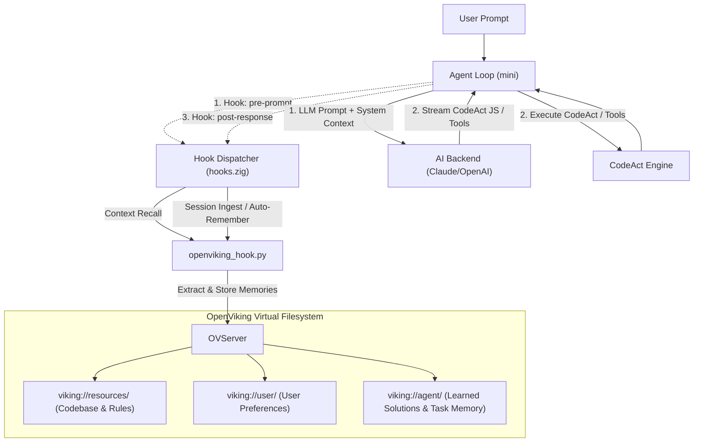

# PROPOSAL: CODEACT EMBEDDED CODE-CENTRIC AGENT ARCHITECTURE FOR MINI
> **Document**: RFC-001 (Revision 7 — Long-Lived Tasks & Lifecycle Context Tracking)  
> **Status**: Implemented / Production  
> **Target System**: `mini-agent` (`mini`)  
> **Core Interpreter**: **Embedded CodeAct (ES2023/ES2024 Modern JavaScript Runtime)**  
> **Repository**: [quickjs-ng/quickjs](https://github.com/quickjs-ng/quickjs)  
> **Author**: Core Team & AI Pair Programmer  
> **Date**: 2026-08-20  

---

## 1. EXECUTIVE SUMMARY

### 1.1. Background: Limitations of JSON Tool-Calling (RPC-style)
The legacy architecture of `mini` was founded upon traditional **JSON Tool-Calling** (Function Calling / RPC):
1. The agent receives user requests, parses intent, and outputs JSON structures (`tool_use`).
2. The `mini` process parses the JSON, dispatches to corresponding handlers (e.g. `grep`, `file_read`, `file_edit`), and transmits results (`tool_result`) back to the LLM.
3. The LLM processes the output and continues the loop.

#### Practical Bottlenecks Encountered:
- **High Turn Latency**: Each granular operation incurs a network roundtrip to the AI Provider. A standard workflow (finding files → reading contents → applying edits → running tests) required **5 to 10 LLM turns** (3–8 seconds per turn).
- **Context Bloating**: Intermediate, unfiltered results (such as 200-line `grep` outputs or full 1,000-line file contents) were dumped directly into the context window, exhausting tokens and inflating costs.
- **Absence of Control Flow**: LLMs could not express `for` loops, `if/else` conditionals, or pipe `|` data across tools in a single turn without roundtripping back to the model.
- **Loss of Long-Term Context & Fragile Long-Running Tasks**: In-memory history was ephemeral (compacting after 40 messages), with no built-in management for background processes (dev servers, test watchers, long builds).

---

### 1.2. Solution: CodeAct + Multi-Tier Execution + Context Hooks
Modernizing `mini`'s tool interaction model via:
- **Embedded In-Process CodeAct Engine**: Directly compiled into the `mini` binary — zero external dependencies, ~200-300KB static footprint.
- All `mini` tools (`fs`, `grep`, `glob`, `http`, `sh`, `artifact`) exported as **in-process C-ABI bindings** inside the global **`mini.*`** object.
- **Long-Lived Task Execution Strategy (OpenHands Pattern)**: Background task API (`mini.shBackground`), process lifecycle tracking via Job IDs, real-time output streaming, and automatic buffer pruning.
- **Automated Context Tracking & Persistent Memory (OpenViking Hook Pattern)**: Leveraging **Lifecycle Hooks** (`hooks.zig`) for transparent session logging, memory extraction, and synchronization with OpenViking Context Databases without consuming LLM tool-calling tokens.
- **Multi-Tier Execution Control System**: Clearly segregating pure CPU infinite loops in JS from legitimate long-running tasks (long I/O, subprocesses, background daemons).

---

## 2. WHY QUICKJS-NG (NEXT GENERATION)?

### 2.1. Comparative Analysis: QuickJS-ng vs Original QuickJS (Bellard) vs LuaJIT

Selecting **QuickJS-ng** was guided by comprehensive technical benchmarks:

| Aspect | QuickJS-ng (Selected ⭐) | Original QuickJS (Bellard) | Lua / LuaJIT |
|:---|:---|:---|:---|
| **ECMAScript Standard** | **ES2023 + ES2024 Stage 4** (Set methods, Iterator Helpers, Promise.try, Float16Array) | ES2020 / limited ES2023 | N/A (Lua 5.1/5.2 syntax) |
| **Maintenance & Velocity** | **Active Community**, bi-monthly releases, test262 per PR | Solo maintainer (slow updates, few PRs) | Frozen at Lua 5.1 ABI |
| **Debugging & Stack Traces** | **High Fidelity**: V8-compatible `Error.captureStackTrace`, exact line/column traces | Basic stack traces | Requires custom debug modules / pcall |
| **Model Generation Accuracy** | **Top-2 (~80-88% Pass@1)** — Near Python parity | ~80-88% Pass@1 | ~45-60% Pass@1 (frequent model syntax errors) |
| **Sandbox & Resource Limits** | **Native C API**: `JS_SetMemoryLimit`, `JS_SetInterruptHandler`, `JS_SetMaxStackSize` | Similar Native C API | Requires disabling JIT + custom allocators + thread termination |
| **Zig Build Integration** | **Seamless** (CMake / `zig-quickjs-ng` / direct static compilation) | Good, but requires Makefile patching | Complex (`zig-luajit-build`) |
| **Memory Safety** | Continuous patches for parsers, memory leaks, and CVEs | Lingering edge-case bugs | FFI sandbox bypass risks |
| **Async / Promise** | Native async/await, Promise lifecycle, job queue | Native async/await | Requires manual coroutine / event loop scaffolding |

---

### 2.2. Key Advantages of QuickJS-ng for mini-agent

#### A. Superior Model Code Generation
LLMs are pre-trained on hundreds of billions of lines of modern JavaScript (GitHub, npm, MDN, StackOverflow). Models demonstrate deep mastery over:
- Destructuring: `const { ok, message } = mini.patch(...)`
- Functional array pipelines: `.map()`, `.filter()`, `.find()`, `.some()`, `.every()`
- Modern control structures: `for...of`, `try...catch...finally`, `async/await`
- Optional chaining `?.` and nullish coalescing `??`

#### B. Accurate Stack Traces Powering the Self-Correction Loop
QuickJS-ng provides detailed stack traces isolating exact error origins at `<eval>:line:col`. This enables `mini` to format high-fidelity error contexts for immediate self-correction:
```
[JS ERROR] TypeError: mini.grpe is not a function
    at runScript (<eval>:14:18)
    at <eval>:25:1
```

---

## 3. HYBRID STRATEGY: JS CODEACT + JSON TOOL FALLBACK

This proposal does **NOT** discard existing JSON tool-calling capabilities. Instead, it adopts a **two-tier hybrid architecture**:

```
                         ┌──────────────────────────────────────┐
                         │       Agent Loop (agent_loop.zig)    │
                         └──────────────┬───────────────────────┘
                                         │
                    ┌───────────────────┴───────────────────┐
                    │                                       │
          [Primary: JS CodeAct]               [Fallback: JSON Tool-Calling]
          - Capable models (Claude 3.7,       - Smaller/compact models (phi-3,
            GPT-4o, Gemini 2.5, DeepSeek)       llama-3, local Ollama)
          - System Prompt details             - Preserves legacy JSON schemas
            mini.* API + JS examples            and tool call routes
          - Code block extraction             - Requires no prompt engineering
            from markdown ```js```              modifications
```

### Execution Modes:
- **`execution_mode = "codeact"` (Default for cloud LLMs)**: Models generate modern JavaScript executed inside the CodeAct VM.
- **`execution_mode = "tools"`**: Fallback compatibility mode.
- **`execution_mode = "auto"`**: Dynamic autonomous selection by the LLM.

---

## 4. TARGET CODEBASE ARCHITECTURE

```
src/
├── main.zig                # CLI Entry point & REPL Loop
├── core/                   # Coordination & State Management
│   ├── agent_loop.zig      # Hybrid Loop (JS CodeAct ↔ JSON Tools, Self-Correction)
│   ├── permissions.zig     # Dynamic Security (Ask / Auto / Yolo)
│   ├── history.zig         # State compaction & execution history management
│   └── contracts.zig       # Interfaces, Event types & Token specs
├── runtime/                # CodeAct Execution Environment
│   ├── quickjs_engine.zig  # JSRuntime/JSContext management, sandbox, heartbeat watchdog
│   ├── js_bindings.zig     # C-ABI bindings: exporting Zig tools to `mini.*`
│   ├── process_manager.zig # Subprocesses, background jobs (OpenHands Pattern) & non-blocking I/O
│   └── shell_runner.zig    # Subprocess runner backing `mini.sh(...)` & `mini.shStream(...)`
├── hooks/                  # Lifecycle Hooks & Context Tracking
│   ├── dispatcher.zig      # Pre-prompt, post-response, pre/post-tool dispatch
│   └── openviking_hook.py  # Bridge for session ingestion & context sync with OpenViking DB
├── stdlib/                 # Core Native Zig Tool Implementations
│   ├── fs_tools.zig        # read, write, patch (diff/exact/regex), exists, stat
│   ├── search_tools.zig    # ripgrep, glob engine
│   ├── http_tools.zig      # HTTP client (sync & async streaming)
│   └── artifact_tools.zig  # Artifact management
├── backend/                # Multi-provider LLM transport (OpenAI, Claude, Ollama)
├── tools/                  # [PRESERVED] Legacy JSON Tool handlers for fallback mode
└── ui/                     # Terminal rendering & Streaming think/code parser
```

---

## 5. `mini.*` API SPECIFICATION IN CODEACT RUNTIME

Upon CodeAct VM initialization per session, the environment exports the standardized global **`mini`** object:

```typescript
// mini OBJECT API SPECIFICATION (CodeAct ES2023+ Runtime)
// ===========================================================================

// 1. Search & Directory Scanning
mini.glob(pattern, basePath?)              // → string[] (list of paths)
mini.grep(pattern, path?, options?)        // → Array<{ path: string, line: number, text: string }>

// 2. File & Directory Manipulation
mini.read(path, offsetLine?, limitLines?)  // → string (file content)
mini.write(path, content)                  // → { ok: boolean, message: string }
mini.patch(path, oldStr, newStr, opts?)    // → { ok: boolean, message: string }
  // opts (object, optional):
  //   occurrence: number   (default 1: replace N-th instance, 0 = all)
  //   regex: boolean       (if true, oldStr is interpreted as regex)
  //   lineStart: number    (constrain search from line)
  //   lineEnd: number      (constrain search to line)
mini.exists(path)                          // → boolean
mini.stat(path)                            // → { size: number, isDir: boolean, isFile: boolean, modified: number }

// 3. System Command Execution (Shell & Process Management — OpenHands Pattern)
mini.sh(command, opts?)                    // → { exitCode: number, stdout: string, stderr: string, ok: boolean }
  // opts: { timeoutMs?: number (default 30000), stdin?: string, cwd?: string }
mini.shStream(command, opts?)              // → number (exitCode)
  // Long-running commands (builds, test suites, migrations). Real-time stdout/stderr streaming.
  // opts: { timeoutMs?: number (0 = unbounded / no limit), cwd?: string }
mini.shBackground(command, opts?)          // → { jobId: string, pid: number, logPath: string }
  // Spawns background process (dev servers, file watchers, long test suites)
mini.jobStatus(jobId)                      // → { running: boolean, exitCode?: number, pid: number }
mini.jobLogs(jobId, lines?: number)        // → string (reads last N lines of log)
mini.jobKill(jobId, signal?: string)       // → boolean (terminates background task)

// 4. HTTP & Networking
mini.http(method, url, opts?)              // → { status: number, headers: Record<string, string>, body: string }
  // opts: { timeoutMs?: number (default 60000), headers?: object, body?: string }

// 5. Artifacts & Session Context
mini.artifact(name, content, metadata?)    // → string (path of generated artifact)
mini.env(varName)                          // → string | null (fetches environment variable)
mini.workspaceRoot                         // → string (active workspace root path)
mini.sessionId                             // → string (unique session identifier)

// 6. Asynchronous Operations (ES2023 Async/Await — Phase 3+)
// await mini.httpAsync(method, url, opts?)
// await Promise.all([mini.httpAsync(...), mini.httpAsync(...)])
```

---

## 6. ERROR RECOVERY & SELF-CORRECTION LOOP

The hallmark of the CodeAct architecture is **autonomous debugging and self-correction** when generated code encounters failures:

```
┌──────────────────────────────────────────────────────────────────────┐
│                     AGENT LOOP (1 User Request)                      │
│                                                                      │
│  [1] LLM generates JavaScript code block                             │
│       │                                                              │
│  [2] Extract code from markdown ```js ... ```                        │
│       │                                                              │
│  [3] Execute in CodeAct VM (Multi-Tier Execution & Sandbox)          │
│       │                                                              │
│       ├── SUCCESS (clean exit, output captured)                      │
│       │     └── Format & truncate output → Forward to LLM            │
│       │         └── LLM analyzes results → replies to user OR        │
│       │             generates subsequent JS code → loop back to [2]  │
│       │                                                              │
│       └── ERROR (syntax error / runtime exception / timeout)         │
│             │                                                        │
│         [4] Format error message from CodeAct:                       │
│             "[JS ERROR] TypeError: mini.grpe is not a function       │
│                  at runScript (<eval>:12:15)"                        │
│             + Complete stack trace                                   │
│             + Original generated code snippet                        │
│             │                                                        │
│         [5] Transmit error context back to LLM                       │
│             │                                                        │
│         [6] LLM inspects stack trace and outputs corrective JS       │
│             │                                                        │
│         [7] If retries >= MAX_JS_RETRIES (3):                        │
│             └── FALLBACK: Transition to legacy JSON tools            │
│                 for the remainder of the interaction                 │
└──────────────────────────────────────────────────────────────────────┘
```

---

## 7. SECURITY MODEL & LONG-RUNNING TASK EXECUTION (OPENHANDS PATTERN)

### 7.1. Flaws of Naive Wall-Clock Timeouts (`JS_SetInterruptHandler` fixed at 30s)

> [!CAUTION]
> **Fatal limitations of static wall-clock interrupts**:
> 1. **Blocking Syscalls vs Bytecode**: When a script calls long commands like `mini.shStream("zig build test")` or `mini.sh("npm install")`, execution control shifts to native Zig code (blocking syscalls or child process waits). QuickJS **executes zero bytecode** during this interval; `JS_SetInterruptHandler` cannot terminate suspended syscalls.
> 2. **Killing Legitimate Work**: Compilations or test suites routinely take 2–10 minutes. A rigid 30s wall-clock limit triggers `JS_SetInterruptHandler` the moment a 40s build completes and returns to JS bytecode, **erroneously killing the script**.
> 3. **Freezing on User Prompts**: When the agent requests confirmation via `permissions.zig: [y/N]`, a user reviewing a diff for 45s will have their script terminated by a 30s wall-clock deadline.

---

### 7.2. Multi-Tier Execution Architecture

To prevent CPU starvation (infinite loops) while accommodating long-lived tasks (I/O, subprocesses, background daemons), `mini` implements a 5-tier control model inspired by OpenHands:

```
┌────────────────────────────────────────────────────────────────────────┐
│               MINI MULTI-TIER EXECUTION ARCHITECTURE                   │
├────────────────────────────────────────────────────────────────────────┤
│ Tier 1: Heartbeat / Activity Watchdog (CodeAct Level)                  │
│   - Interrupts only upon sustained CPU starvation (e.g. while(true){}) │
│   - Automatically renews heartbeat timestamp on I/O or output activity │
├────────────────────────────────────────────────────────────────────────┤
│ Tier 2: Native OS-Level Subprocess & Network Timeout (Zig Level)       │
│   - Granular, independent timeouts: mini.sh(cmd, {timeoutMs})          │
│   - mini.shStream defaults to timeoutMs = 0 (unbounded long tasks)     │
│   - Managed via Process Groups (killpg) + POSIX SIGTERM / SIGKILL      │
├────────────────────────────────────────────────────────────────────────┤
│ Tier 3: User Interaction Freeze (Permission Level)                     │
│   - Suspends (PAUSE) all watchdogs while waiting on user [y/N] input   │
├────────────────────────────────────────────────────────────────────────┤
│ Tier 4: Manual Cancellation (Signal Level)                             │
│   - Intercepts Ctrl+C (SIGINT): cancels subprocesses and CodeAct VM    │
├────────────────────────────────────────────────────────────────────────┤
│ Tier 5: Background Task Manager & Log Inspection (OpenHands Pattern)   │
│   - Supports mini.shBackground("npm run dev") for daemons & watchers   │
│   - Polls output via mini.jobLogs(jobId) on subsequent turns           │
└────────────────────────────────────────────────────────────────────────┘
```

#### Technical Specifications:

1. **Heartbeat / Activity Watchdog in CodeAct**:
   - `JS_SetInterruptHandler` **does not track cumulative wall-clock time**, but measures **continuous CPU burst time without I/O (`MAX_CPU_BURST_MS = 5000ms`)**.
   - Invoking `mini.read`, `mini.write`, `mini.sh`, `mini.http`, or `console.log(...)` immediately **renews the watchdog activity pointer**.
2. **Native Subprocess Timeout Management (Zig Level)**:
   - `mini.sh(cmd, { timeoutMs: 30000 })`: Short commands (default 30s).
   - `mini.shStream(cmd, { timeoutMs: 0 })`: Long commands (unbounded by default, direct terminal streaming).
   - On timeout: Zig dispatches `SIGTERM` (followed by `SIGKILL` after 2s) to the process group (`killpg(child_pid, SIGTERM)`).
3. **Watchdog Freeze During User Interaction**:
   - When `permissions.zig` displays `[y/N]`, `state.is_paused = true` is set, freezing the watchdog timer.
4. **Background Tasks & Log Inspection Strategy (OpenHands Model)**:
   - Long-lived tasks (dev servers, long test suites): Agent calls `mini.shBackground(cmd)`, immediately returning `{ jobId, pid, logPath }`.
   - On subsequent turns, the agent invokes `mini.jobLogs(jobId, 50)` to inspect trailing log lines or `mini.jobStatus(jobId)` without blocking main loop execution.

---

## 8. AUTOMATED CONTEXT TRACKING & PERSISTENT MEMORY (OPENVIKING HOOK PATTERN)

> **Scope**: For context window management, compaction, and long-term memory, RFC-003 (MemAct) remains the **normative standard**. This section details the **OpenViking transport/bridge layer** — an external memory backend complementing RFC-003's native MemoryStore. If the OpenViking bridge is absent, mini maintains full memory capabilities via RFC-003.

To overcome context loss when History is compacted (`DEFAULT_MAX_MESSAGES = 40`), `mini` connects with the **OpenViking Context Database** via **Lifecycle Hooks** (`src/hooks.zig`):



### Operational Workflow:
1. **Zero LLM Token Overhead**: Context logging and memory extraction execute transparently via Lifecycle Hooks without consuming model tool calls.
2. **`pre-prompt` Event**: Retrieves project guidelines and user preferences from `viking://user/` and `viking://resources/` to enrich prompt context.
3. **`post-response` & `post-tool-use` Events**: Packages user prompts, scripts, tool outputs, and answers to OpenViking `/api/v1/sessions/turn`, extracting recurring patterns and entities.

---

## 9. WORKFLOW EXAMPLE: 1-TURN MODERN JAVASCRIPT SCENARIO

### Scenario: Locating Zig files, applying patches, running comprehensive test suites, and launching a background dev daemon:

```javascript
// LLM outputs a complete ES2023+ script in a single Turn:
const files = mini.glob("**/*.zig", "src");
console.log(`Scanning ${files.length} Zig files in src/...`);

const modifiedFiles = [];

for (const file of files) {
    const content = mini.read(file);
    if (content?.includes("openDir(io, search_path, .{})")) {
        const { ok, message } = mini.patch(
            file,
            "openDir(io, search_path, .{})",
            "openDir(io, search_path, .{ .iterate = true })"
        );
        if (ok) {
            modifiedFiles.push(file);
            console.log(`  ✓ Applied fix in: ${file}`);
        } else {
            console.log(`  ✗ Patch failed for ${file}: ${message}`);
        }
    }
}

console.log(`\nTotal files modified: ${modifiedFiles.length}`);

// 1. Run test validation (streaming output, timeoutMs = 0 allows long runs)
if (modifiedFiles.length > 0) {
    console.log("\n--- Executing zig build test ---");
    const exitCode = mini.shStream("zig build test", { timeoutMs: 0 });
    if (exitCode === 0) {
        console.log("✓ All tests passed successfully!");
        
        // 2. Launch background dev server (OpenHands Pattern)
        console.log("\n--- Starting mini dev daemon ---");
        const job = mini.shBackground("./zig-out/bin/mini --server");
        console.log(`✓ Dev daemon running in background with Job ID: ${job.jobId} (PID: ${job.pid})`);
    } else {
        console.log(`✗ Tests failed with exit code: ${exitCode}`);
    }
}
```

---

## 10. PERFORMANCE & RESOURCE IMPACT (ESTIMATED)

| Metric | Legacy JSON Tool-Calling | Modern CodeAct | Improvement |
| :--- | :--- | :--- | :--- |
| **LLM Turns (4-step task)** | 6 – 10 Turns | 1 – 3 Turns (with retries) | **60% – 75% Reduction** |
| **First-Turn Code Accuracy** | N/A (JSON Schema) | ~80% – 88% (Pass@1) | Substantially higher than Lua (~50%) |
| **Context Token Consumption** | 15,000 – 30,000 tokens | 3,000 – 7,000 tokens | **~65% – 75% Savings** |
| **Context Retention** | Lost after 40-msg compaction | Persistent via OpenViking Hooks | **Infinite Horizon** |
| **Long-Lived Task Execution** | Isolated sequential calls | Subprocess timeouts, streaming & background daemons | **Full Flexibility** |

---

## 11. 4-PHASE IMPLEMENTATION ROADMAP

### Phase 1: CodeAct Engine, Multi-Tier Watchdog & C-ABI Bindings
- [ ] Integrate `quickjs-ng` into `build.zig` (via `zig-quickjs-ng` dependency or static compilation).
- [ ] Implement `src/runtime/quickjs_engine.zig`:
  - Initialize `JSRuntime` + `JSContext`.
  - Implement **Heartbeat Activity Watchdog** (`renewActivity`, `max_cpu_burst_ms = 5000ms`).
  - Configure resource limits: `JS_SetMemoryLimit(128MB)`, `JS_SetMaxStackSize(1MB)`.
  - Whitelist globals: Safe JS built-ins + `console.log` capture buffer (64KB cap).
- [ ] Implement `src/runtime/process_manager.zig`:
  - Manage subprocesses with independent timeouts, stream pipe draining, process group termination on timeout / SIGINT.
  - Background task support (`mini.shBackground`, `jobStatus`, `jobLogs`, `jobKill`).
- [ ] Implement `src/runtime/js_bindings.zig`:
  - C-ABI bindings for `mini.*` (`glob`, `grep`, `read`, `write`, `patch`, `sh`, `shStream`, `shBackground`, `jobStatus`, `jobLogs`, `jobKill`, `http`, `artifact`, `exists`, `stat`, `env`).
- [ ] **A/B Benchmarks**: Validate against integration test suites (using `testcases/run_bfcl_benchmark.sh`).

### Phase 2: CodeAct Agent Loop & Lifecycle Context Tracking
- [ ] Update `src/core/agent_loop.zig`:
  - Code block extraction (detecting ````js ... ```` / ````javascript ... ````).
  - Self-correction loop (up to 3 retries from CodeAct stack traces, falling back to JSON tools).
  - Configure `execution_mode`: `"codeact"` | `"tools"` | `"auto"`.
- [ ] Integrate **OpenViking Lifecycle Hook Bridge** (`scripts/openviking_hook.py`) with `src/hooks.zig` for automated session ingestion & context recall.
- [ ] Update System Prompts with `mini.*` references and idiomatic JavaScript examples (including background process patterns).

### Phase 3: Async Operations & Promise Lifecycle
- [ ] Provide `mini.httpAsync()` returning Promises, with event loop processing via `JS_ExecutePendingJob`.
- [ ] Support `await Promise.all([...])` for concurrent I/O operations.
- [ ] Integrate interrupt hooks to freeze JS execution when displaying interactive user permission prompts (`permissions.zig`).

### Phase 4: ACP (Agent Control Protocol) & Headless Embeddability
- [ ] Support JSON-RPC ACP protocols allowing external IDEs and headless clients to embed and drive `mini` sessions remotely.
