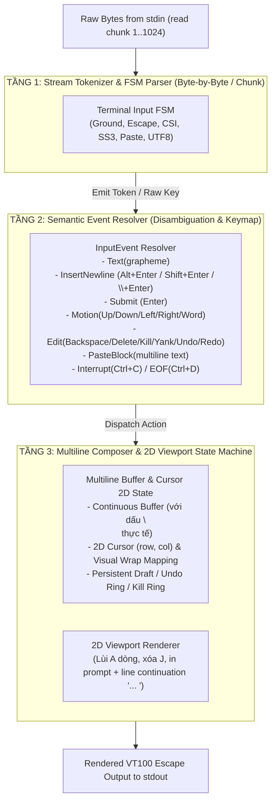

# RFC-008: Terminal User Input State Machine & Multiline Composer Proposal

> **Ngày:** 2026-08-28  
> **Trạng thái:** Proposed  
> **Tác giả:** mini-agent team  
> **Mục tiêu:** Thay thế toàn bộ cơ chế phân giải phím/escape ad-hoc bằng **Finite State Machine (FSM)** hình thức 3 tầng, hỗ trợ chuẩn xác Paste nhiều dòng (Bracketed Paste), Alt/Shift Key Combinations, Unicode UTF-8 Graphemes và Multiline Editing.

---

## 1. Vấn đề của cơ chế Ad-hoc hiện tại

Trong phiên bản hiện tại (`src/ui/editor.zig` và `src/ui/paste.zig`):
1. **Lỗi nuốt xuống dòng khi Paste**: `paste.zig` biến đổi toàn bộ `\r\n` và `\n` thành khoảng trắng (`' '`), khiến code snippet và prompt nhiều dòng bị dính thành 1 dòng duy nhất.
2. **Xử lý Escape Sequence phân mảnh**: Dùng `slice[0..3]` và các nhánh `if (seq_buf[0] == 0x1b ...)` rời rạc, dễ vỡ khi byte của một chuỗi escape bị tách qua 2 lần gọi `read()` từ OS.
3. **Thiếu hỗ trợ phím bổ trợ (Modifiers)**: Không phân giải được các tổ hợp phím hiện đại (`Alt+Enter`, `Shift+Enter`, `modifyOtherKeys`, `kitty keyboard protocol`).
4. **Không có phân tầng tách biệt**: Logic đọc byte thô, parse ANSI sequence, quản lý buffer text và render viewport bị trộn lẫn trong một hàm `readLine()` khổng lồ.

---

## 2. Kiến Trúc 3 Tầng (3-Layer Input Architecture)



---

## 3. Chi Tiết State Machine Tầng 1 (Input Parser FSM)

Trình phân tích FSM tiếp nhận từng byte tuần tự từ stream `stdin`, không phụ thuộc vào kích thước chunk của OS:


---

## 4. Bảng Chuyển Trạng Thái Chi Tiết (Transition Table)

| Trạng thái hiện tại | Input Byte | Trạng thái tiếp theo | Hành động / Event phát ra |
|---|---|---|---|
| **Ground** | `0x1B` (ESC) | `Escape` | Khởi động timer timeout 50ms |
| **Ground** | `0x0D` (`\r` Enter) | `Ground` | `Event.Submit` (Nếu buffer kết thúc bằng `\`: chuyển thành `InsertNewline`) |
| **Ground** | `0x0A` (`\n` Ctrl+J) | `Ground` | `Event.InsertNewline` |
| **Ground** | `0x03` (Ctrl+C) | `Ground` | `Event.Interrupt` (Hủy dòng đang nhập / đếm 2 lần thoát REPL) |
| **Ground** | `0x04` (Ctrl+D) | `Ground` | `Event.Eof` (Nếu rỗng: thoát REPL; nếu có text: Delete) |
| **Ground** | `0x7F` / `0x08` (Backspace) | `Ground` | `Event.Backspace` (Xóa 1 grapheme cluster) |
| **Ground** | `0x20..0x7E` | `Ground` | `Event.InsertText(byte)` |
| **Ground** | `0xC0..0xF7` (UTF-8 Lead) | `UTF8_Accum` | Khởi tạo buffer Unicode (chờ 1..3 byte tiếp theo) |
| **Escape** | `[` | `CSI_Entry` | Chờ tham số CSI |
| **Escape** | `O` | `SS3_Entry` | Chờ phím SS3 (`H` Home, `F` End) |
| **Escape** | `0x0D` / `0x0A` (Alt+Enter) | `Ground` | **`Event.InsertNewline` (Xuống dòng trong Composer)** |
| **Escape** | `'b'` / `'B'` (Alt+B) | `Ground` | `Event.WordLeft` |
| **Escape** | `'f'` / `'F'` (Alt+F) | `Ground` | `Event.WordRight` |
| **Escape** | `'d'` / `'D'` (Alt+D) | `Ground` | `Event.KillWordRight` |
| **Escape** | `0x7F` (Alt+Backspace) | `Ground` | `Event.KillWordLeft` |
| **CSI_Entry** | `'A'` / `'B'` | `Ground` | `Event.CursorUp` / `Event.CursorDown` (hoặc History) |
| **CSI_Entry** | `'C'` / `'D'` | `Ground` | `Event.CursorRight` / `Event.CursorLeft` |
| **CSI_Entry** | `'H'` / `'F'` | `Ground` | `Event.LineHome` / `Event.LineEnd` |
| **CSI_Param** | `13;2u` / `13;3u` (Kitty/xterm) | `Ground` | **`Event.InsertNewline` (Shift+Enter / Alt+Enter)** |
| **CSI_Param** | `200~` | `Bracketed_Paste` | Chuyển sang chế độ Paste khối lớn |
| **Bracketed_Paste**| `\n`, `\r\n`, Text, Tabs | `Bracketed_Paste` | **Ghi nhận nguyên vẹn `\n` và khoảng trắng vào buffer** |
| **Bracketed_Paste**| `\x1b[201~` | `Ground` | **Emit `Event.PasteBlock(content)`** |

---

## 5. Quy Tắc Xuống Dòng & Paste Nhiều Dòng (Multiline Rules)

### A. Cơ chế Paste nhiều dòng (Bracketed Paste)
* Khi terminal gửi `\x1b[200~` $\to$ FSM chuyển sang trạng thái `Bracketed_Paste`.
* Toàn bộ các dòng mã, dấu xuống dòng `\n`, `\r\n` và thụt đầu dòng (Indentation/Tabs) được **giữ nguyên 100%**, không bị biến đổi thành khoảng trắng.
* Khi gặp `\x1b[201~` $\to$ chèn toàn bộ khối văn bản vào buffer tại vị trí con trỏ hiện tại và kích hoạt Redraw 2D.

### B. Các cách xuống dòng khi gõ phím thủ công (Manual Newline Insert)
Người dùng có thể xuống dòng trong REPL bằng 4 cách chuẩn:
1. **`Alt + Enter`** (Gửi sequence `\x1b\r`, `\x1b\n`, hoặc `\x1b[13;3u`).
2. **`Shift + Enter`** (Gửi sequence `\x1b[13;2u` hoặc `\x1b[27;2;13~`).
3. **`Ctrl + J`** (Gửi byte `0x0A` trong raw terminal mode).
4. **Line Continuation bằng Backslash (`\`)**: Gõ ký tự `\` ở cuối dòng rồi nhấn `Enter` $\to$ hệ thống tự xóa dấu `\` và chèn `\n`.

### C. Quy tắc Submit Prompt
* Nhấn **`Enter` (`\r`) thông thường** khi không có dấu `\` ở cuối dòng $\to$ Gửi toàn bộ prompt (gồm tất cả các dòng đã soạn) sang `AgentLoop.processInput()`.

---

## 6. Thiết Kế Cấu Trúc Dữ Liệu Trong Zig (Data Structures Blueprint)

```zig
pub const InputEvent = union(enum) {
    insert_text: []const u8,
    insert_newline: void,
    paste_block: []const u8,
    submit: void,
    backspace: void,
    delete: void,
    cursor_left: void,
    cursor_right: void,
    cursor_up: void,
    cursor_down: void,
    word_left: void,
    word_right: void,
    line_home: void,
    line_end: void,
    buffer_top: void,
    buffer_bottom: void,
    kill_word_left: void,
    kill_word_right: void,
    kill_to_line_end: void,
    yank: void,
    undo: void,
    redo: void,
    redraw: void,
    interrupt: void, // Ctrl+C
    eof: void,       // Ctrl+D
};

pub const FSMState = enum {
    ground,
    escape_received,
    csi_entry,
    csi_param,
    ss3_entry,
    alt_pending,
    bracketed_paste,
    paste_escape,
    paste_end_candidate,
    utf8_accum,
};

pub const InputStateMachine = struct {
    state: FSMState = .ground,
    param_buf: [32]u8 = undefined,
    param_len: usize = 0,
    utf8_buf: [4]u8 = undefined,
    utf8_expected: usize = 0,
    utf8_got: usize = 0,
    paste_buf: std.ArrayListUnmanaged(u8) = .empty,
    
    pub fn feedByte(self: *InputStateMachine, alloc: std.mem.Allocator, byte: u8) ?InputEvent {
        // State transitions implementation based on Section 4
    }
};
```

---

## 7. Kế Hoạch Triển Khai (Implementation Roadmap)

- [ ] **M1: Refactor Parser Module (`src/ui/input_fsm.zig`)**: Triển khai `InputStateMachine` độc lập với unit tests toàn diện (100% coverage cho escape sequences, bracketed paste, multiline newlines, unicode).
- [ ] **M2: Cập nhật `src/ui/paste.zig`**: Giữ nguyên `\n` trong `sanitizeAppend` và hỗ trợ chunk streaming.
- [ ] **M3: Nâng cấp `redraw()` trong `src/ui/editor.zig`**: Tính toán tọa độ 2D cho buffer chứa nhiều dấu `\n` thực tế (kèm visual wrap và continuation prefix `... `).
- [ ] **M4: Tích hợp vào `LineEditor.readLine()`**: Thay thế toàn bộ cụm `switch(c)` ad-hoc bằng vòng lặp `while (fsm.feedByte(b)) |event| dispatchEvent(event)`.
