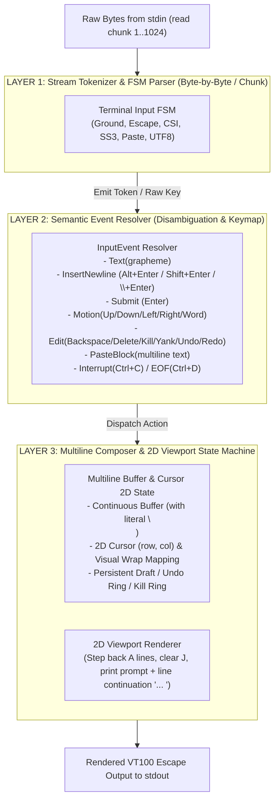

# RFC-008: Terminal User Input State Machine & Multiline Composer Proposal

> **Date:** 2026-08-28  
> **Status:** In Progress / Partially Implemented (Phase 1: Incremental Bracketed Paste Parser at `src/ui/paste.zig` completed; Phase 2-4 Multiline FSM in progress)  
> **Author:** mini-agent team  
> **Goal:** Replace ad-hoc key/escape resolution with a formal 3-layer **Finite State Machine (FSM)**, supporting accurate Multiline Paste (Bracketed Paste), Alt/Shift Key Combinations, Unicode UTF-8 Graphemes, and Multiline Editing.

---

## 1. Issues with Current Ad-hoc Implementation

In the legacy implementation (`src/ui/editor.zig` and `src/ui/paste.zig`):
1. **Newline Swallowing on Paste**: `paste.zig` converted all `\r\n` and `\n` into spaces (`' '`), collapsing multiline code snippets and prompts into a single line.
2. **Fragmented Escape Sequence Handling**: Used `slice[0..3]` and ad-hoc `if (seq_buf[0] == 0x1b ...)` branches, easily breaking when an escape sequence's bytes were split across OS `read()` calls.
3. **Missing Modifier Key Support**: Unable to disambiguate modern combinations (`Alt+Enter`, `Shift+Enter`, `modifyOtherKeys`, `kitty keyboard protocol`).
4. **Lack of Layered Separation**: Raw byte reading, ANSI sequence parsing, text buffer management, and viewport rendering were entangled in a massive `readLine()` function.

---

## 2. 3-Layer Input Architecture



---

## 3. Layer 1 State Machine Details (Input Parser FSM)

The FSM parser consumes incoming bytes sequentially from the `stdin` stream, regardless of OS chunk boundaries:

```mermaid
stateDiagram-v2
    [*] --> Ground

    Ground --> Escape : byte == 0x1B (ESC)
    Ground --> Ground : byte in [0x20..0x7E] -> Emit Text(ASCII)
    Ground --> Ground : byte in [0x01..0x1A] -> Emit ControlKey (Ctrl+A..Z)
    Ground --> Ground : byte == 0x0D (Enter) -> Emit Submit
    Ground --> Ground : byte == 0x0A (Ctrl+J) -> Emit InsertNewline
    Ground --> UTF8_Accum : byte >= 0xC0 (UTF-8 Lead Byte)

    UTF8_Accum --> UTF8_Accum : byte in [0x80..0xBF] (Continuation)
    UTF8_Accum --> Ground : Complete UTF-8 -> Emit Text(Multibyte)

    Escape --> CSI_Entry : byte == '['
    Escape --> SS3_Entry : byte == 'O'
    Escape --> Alt_Pending : byte in [0x20..0x7E, 0x0D, 0x0A, 0x7F]
    Escape --> Ground : Timeout (>50ms no subsequent byte) -> Emit EscapeKey

    CSI_Entry --> CSI_Param : byte in ['0'..'9', ';', '?']
    CSI_Entry --> Ground : byte in ['A'..'Z', '~'] -> Emit CSI Command (Arrows, Home, End...)

    CSI_Param --> CSI_Param : byte in ['0'..'9', ';']
    CSI_Param --> Bracketed_Paste : Param == "200~"
    CSI_Param --> Ground : Final Byte in ['A'..'Z', '~', 'u'] -> Emit Modified Key (Alt+Arrows, Shift+Enter...)

    Bracketed_Paste --> Bracketed_Paste : Any text byte, \\n, \\r, \\t -> Store in PasteBuffer
    Bracketed_Paste --> Paste_Escape : byte == 0x1B (ESC)
    
    Paste_Escape --> Paste_End_Candidate : byte == '['
    Paste_Escape --> Bracketed_Paste : byte != '[' (ESC char inside pasted content)

    Paste_End_Candidate --> Ground : Match "201~" -> Emit PasteBlock(PasteBuffer)
    Paste_End_Candidate --> Bracketed_Paste : Mismatch -> Flush buffer & continue Paste
```



---

## 4. Detailed State Transition Table

| Current State | Input Byte | Next State | Action / Emitted Event |
|---|---|---|---|
| **Ground** | `0x1B` (ESC) | `Escape` | Start 50ms timeout timer |
| **Ground** | `0x0D` (`\r` Enter) | `Ground` | `Event.Submit` (If buffer ends with `\`: convert to `InsertNewline`) |
| **Ground** | `0x0A` (`\n` Ctrl+J) | `Ground` | `Event.InsertNewline` |
| **Ground** | `0x03` (Ctrl+C) | `Ground` | `Event.Interrupt` (Cancel active input / 2 successive presses exit REPL) |
| **Ground** | `0x04` (Ctrl+D) | `Ground` | `Event.Eof` (If empty: exit REPL; if text present: Delete) |
| **Ground** | `0x7F` / `0x08` (Backspace) | `Ground` | `Event.Backspace` (Delete 1 grapheme cluster) |
| **Ground** | `0x20..0x7E` | `Ground` | `Event.InsertText(byte)` |
| **Ground** | `0xC0..0xF7` (UTF-8 Lead) | `UTF8_Accum` | Initialize Unicode buffer (await next 1..3 bytes) |
| **Escape** | `[` | `CSI_Entry` | Await CSI parameters |
| **Escape** | `O` | `SS3_Entry` | Await SS3 key (`H` Home, `F` End) |
| **Escape** | `0x0D` / `0x0A` (Alt+Enter) | `Ground` | **`Event.InsertNewline` (Newline in Composer)** |
| **Escape** | `'b'` / `'B'` (Alt+B) | `Ground` | `Event.WordLeft` |
| **Escape** | `'f'` / `'F'` (Alt+F) | `Ground` | `Event.WordRight` |
| **Escape** | `'d'` / `'D'` (Alt+D) | `Ground` | `Event.KillWordRight` |
| **Escape** | `0x7F` (Alt+Backspace) | `Ground` | `Event.KillWordLeft` |
| **CSI_Entry** | `'A'` / `'B'` | `Ground` | `Event.CursorUp` / `Event.CursorDown` (or History) |
| **CSI_Entry** | `'C'` / `'D'` | `Ground` | `Event.CursorRight` / `Event.CursorLeft` |
| **CSI_Entry** | `'H'` / `'F'` | `Ground` | `Event.LineHome` / `Event.LineEnd` |
| **CSI_Param** | `13;2u` / `13;3u` (Kitty/xterm) | `Ground` | **`Event.InsertNewline` (Shift+Enter / Alt+Enter)** |
| **CSI_Param** | `200~` | `Bracketed_Paste` | Enter bulk paste mode |
| **Bracketed_Paste**| `\n`, `\r\n`, Text, Tabs | `Bracketed_Paste` | **Record verbatim `\n` and spaces into buffer** |
| **Bracketed_Paste**| `\x1b[201~` | `Ground` | **Emit `Event.PasteBlock(content)`** |

---

## 5. Multiline Rules & Insertion Mechanisms

### A. Multiline Paste (Bracketed Paste)
* When terminal emits `\x1b[200~` $\to$ FSM transitions to `Bracketed_Paste`.
* All code lines, `\n`, `\r\n`, and indentation tabs are **preserved 100%**, without conversion to spaces.
* When encountering `\x1b[201~` $\to$ insert the entire text block at the active cursor position and trigger 2D redraw.

### B. Manual Newline Insertion
Users can insert newlines in the REPL using 4 standard mechanisms:
1. **`Alt + Enter`** (Emits `\x1b\r`, `\x1b\n`, or `\x1b[13;3u`).
2. **`Shift + Enter`** (Emits `\x1b[13;2u` or `\x1b[27;2;13~`).
3. **`Ctrl + J`** (Emits `0x0A` in raw terminal mode).
4. **Line Continuation with Backslash (`\`)**: Typing `\` at the line end followed by `Enter` $\to$ system trims `\` and inserts `\n`.

### C. Prompt Submission Rules
* Standard **`Enter` (`\r`)** without a trailing `\` $\to$ Submits entire prompt (including all composed lines) to `AgentLoop.processInput()`.

---

## 6. Zig Data Structures Blueprint

```zig
pub const InputEvent = union(enum) {
    insert_text: []const u8,
    insert_newline: void,
    paste_block: []const u8,
    submit: void,
    backspace: void,
    delete: void,
    cursor_left: void,
    cursor_right: void,
    cursor_up: void,
    cursor_down: void,
    word_left: void,
    word_right: void,
    line_home: void,
    line_end: void,
    buffer_top: void,
    buffer_bottom: void,
    kill_word_left: void,
    kill_word_right: void,
    kill_to_line_end: void,
    yank: void,
    undo: void,
    redo: void,
    redraw: void,
    interrupt: void, // Ctrl+C
    eof: void,       // Ctrl+D
};

pub const FSMState = enum {
    ground,
    escape_received,
    csi_entry,
    csi_param,
    ss3_entry,
    alt_pending,
    bracketed_paste,
    paste_escape,
    paste_end_candidate,
    utf8_accum,
};

pub const InputStateMachine = struct {
    state: FSMState = .ground,
    param_buf: [32]u8 = undefined,
    param_len: usize = 0,
    utf8_buf: [4]u8 = undefined,
    utf8_expected: usize = 0,
    utf8_got: usize = 0,
    paste_buf: std.ArrayListUnmanaged(u8) = .empty,
    
    pub fn feedByte(self: *InputStateMachine, alloc: std.mem.Allocator, byte: u8) ?InputEvent {
        // State transitions implementation based on Section 4
    }
};
```

---

## 7. Implementation Roadmap

- [ ] **M1: Refactor Parser Module (`src/ui/input_fsm.zig`)**: Implement standalone `InputStateMachine` with comprehensive unit tests (100% coverage for escape sequences, bracketed paste, multiline newlines, unicode).
- [ ] **M2: Update `src/ui/paste.zig`**: Preserve `\n` in `sanitizeAppend` and support chunk streaming.
- [ ] **M3: Upgrade `redraw()` in `src/ui/editor.zig`**: Calculate 2D coordinates for buffers containing literal `\n` (with visual wrap and continuation prefix `... `).
- [ ] **M4: Integrate into `LineEditor.readLine()`**: Replace ad-hoc `switch(c)` with `while (fsm.feedByte(b)) |event| dispatchEvent(event)` event loop.
