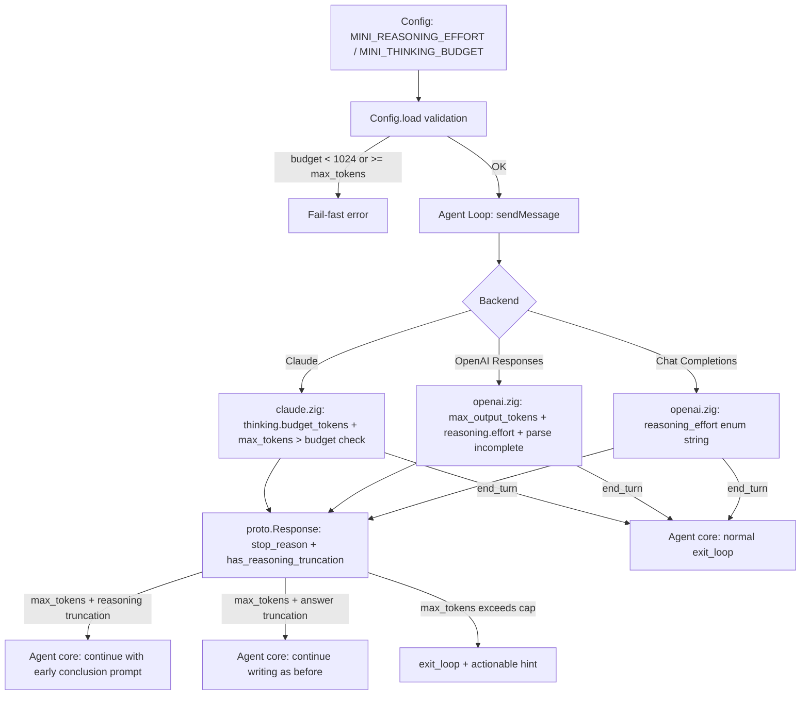

# RFC-009: Thinking Budget & Reasoning Effort Proposal — Managing Reasoning Tokens When Responses are Truncated by max_tokens

> **Date:** 2026-09-03
> **Status:** Proposed
> **Author:** mini-agent team
> **Goal:** Standardize control over **Thinking Budget** (Anthropic `thinking.budget_tokens`) and **Reasoning Effort** (OpenAI `reasoning.effort` / `reasoning_effort`), while addressing **untracked truncation when responses are cut off mid-reasoning** — currently only `finish_reason: length` / `stop_reason: max_tokens` triggers a continue-loop.

---

## 1. Problem Statement

### 1.1. Anthropic Extended Thinking — Parsing Implemented, Requests Omitted

In `src/backends/claude.zig`:
- The parser **fully supports** `content_block_start(thinking)` / `thinking_delta` / `signature_delta` (lines ~299-375) and message replay includes `content: [{type:"thinking", ...}]`.
- However, `buildRequestBody` only emits `{"model":..., "max_tokens":..., "stream":true, ...}` — **never sending the `thinking` parameter**, so extended thinking is never triggered server-side. The parsing capability remains unused in the code.

### 1.2. OpenAI Responses API — No Limit, Untracked Truncation

In `src/backends/openai.zig`:
- `buildResponsesRequestBody` executes `_ = max_tokens;` (lines ~295): **does not send `max_output_tokens`** → server falls back to default (often massive) or rejects the call.
- `reasoning.effort` is hardcoded to `"medium"`, uncontrollable by user configuration.
- The parser ignores the `response.incomplete` event as well as `status:"incomplete"` / `incomplete_details.reason == "max_output_tokens"` in Responses API (lines ~586) → responses cut off mid-**reasoning** fail to set `stop_reason = .max_tokens` and are mistakenly marked `.end_turn`. This is risky with reasoning models because truncated tokens fall inside **thinking** rather than the final answer — users observe spinners/TTFT running, followed by an empty response or an abrupt stop.

### 1.3. Chat Completions — Missing Controls for Effort Levels

In `src/backends/openai.zig`: `buildRequestBody` (lines ~377) sends `"reasoning_effort":"none"` when disabled (standard API format to disable reasoning), but when enabled it **does not send any `reasoning_effort` parameter** (relying on server defaults) — lacking granular control over effort levels (`low`, `medium`, `high`) for reasoning model families (o-series, GPT-5.x, DeepSeek-R1, Qwen3, ...).

### 1.4. Agent Core — Unbounded Continuations, No Truncation Context Distinction

In `src/core/agent.zig` `switch (response.stop_reason)`:
- `.max_tokens` → increments `max_tokens_continues`, inserts user message "[System] ... continue EXACTLY from where you stopped". However:
  - **No upper limit on continuations** → risk of infinite loops (burning credits, hanging terminals) if the server continuously returns `length`.
  - **No distinction between truncation during thinking vs answer**: current continuation prompts are semantically misleading for reasoning models (instructing the model to "continue writing" when thinking was truncated before generating any actual answer text).
  - Does not track turn-level token costs during repeated truncations (related to RFC-002 `budget_max_tokens`).

---

## 2. Goals & Non-Goals

### Goals
1. **Unified Configuration**: Configure `reasoning_effort` + `thinking_budget` once (via config.json / env), letting backend adapters translate to provider wire formats.
2. **Leverage Existing Capabilities**: Claude's parser is ready — complete the request side without disturbing the Agent Loop unnecessarily.
3. **Infinite Loop Protection**: Cap continuations when responses are truncated; distinguish thinking truncation from answer truncation.
4. **Backward Compatibility**: Default behavior remains unchanged (omitting thinking params unless configured).

### Non-Goals
- Modifying the Agent Loop / CodeAct protocol.
- Dynamic auto-adjustment of budgets based on task complexity (expose static config + simple heuristics only).
- Streaming granular token usage breakdowns for reasoning (usage continues to be parsed via standard fields).

---

## 3. Detailed Design

### 3.1. Config Layer (`src/core/config.zig`)

Add new fields:

```zig
/// Reasoning effort for OpenAI-compatible models: "minimal" | "low" | "medium" | "high" | null (=off).
reasoning_effort: ?[]const u8 = null,
/// Soft off-switch, set to true to force omitting reasoning params (backend compatibility).
reasoning_effort_disabled: bool = false,
/// Anthropic thinking budget (tokens). Null = extended thinking disabled.
thinking_budget_tokens: ?u32 = null,
/// Anthropic thinking temperature: only 1.0 is permitted when thinking is enabled (API requirement).
thinking_temperature: f32 = 1.0,
/// Maximum number of automatic continuations when response is truncated by max_tokens (per turn).
max_tokens_continue_cap: usize = 3,
```

Corresponding env/config keys: `MINI_REASONING_EFFORT`, `MINI_THINKING_BUDGET`, `MINI_MAX_TOKENS_CONTINUE_CAP`.

**Validation Rules (in Config.load):**
- `thinking_budget_tokens` must be **>= 1024** (Anthropic minimum requirement) and **< max_tokens** (thinking budget must be smaller than max_tokens).
- `reasoning_effort` ∈ {minimal, low, medium, high} — other strings trigger a config error upon loading (fail-fast).
- When `thinking_budget_tokens != null`, agent must **strip temperature/top_p if user sets non-1.0 values** (Anthropic mandates temperature=1 for extended thinking) — warn on stderr and override.

### 3.2. Claude Adapter (`src/backends/claude.zig`)

Update `buildRequestBody` signature to accept `thinking_budget: ?u32`:

```json
{
  "model": "...",
  "max_tokens": 24000,
  "stream": true,
  "system": [...],
  "messages": [...], 
  "thinking": { "type": "enabled", "budget_tokens": 4096 }
}
```

- Only attach the `thinking` object when `thinking_budget != null` (ensuring backward compatibility).
- Wire format adheres to Anthropic Messages API for models with fixed budgets (Claude 3.7): `thinking: { type: "enabled", budget_tokens: N }`, **subject to `max_tokens > budget_tokens`** (enforced client-side prior to serialization).
- For next-generation Anthropic models utilizing **Adaptive Thinking** (such as Claude Opus 4.7+, Sonnet 5), the API requires `thinking: { type: "adaptive" }` paired with `output_config.effort` instead of a fixed `budget_tokens` (see §6 Open Questions).
- No changes required for response parsing — `thinking_delta` parser already handles incoming blocks.

### 3.3. OpenAI Adapter (`src/backends/openai.zig`)

#### 3.3.1. Responses API (`buildResponsesRequestBody`)
- **Send `max_output_tokens`** instead of ignoring it: derive from configured `max_tokens` + reasoning buffer: `max_output_tokens = max_tokens + thinking_budget_hint` (preventing reasoning tokens from consuming the entire answer budget).
- **`reasoning: { effort: <effort> }`** loaded from config, avoiding hardcoded `"medium"`; `effort:"none"` used only when `reasoning_effort_disabled` or effort is null.
- **Intercept `event: response.incomplete` and parse `status == "incomplete"` / `incomplete_details.reason == "max_output_tokens"`** in SSE stream handler ([openai.zig:586](file:///mnt/hdd/projects/persional/mini/src/backends/openai.zig#L586)) → set `stop_reason = .max_tokens` in `StreamCtx` instead of default `.end_turn` — triggering the Agent Core continue-loop.

#### 3.3.2. Chat Completions (`buildRequestBody`)
- `reasoning_effort` field emits configured effort string (minimal|low|medium|high), rather than solely "none".
- When `reasoning_effort_disabled` (or model heuristics indicate incompatibility with tools) → send `reasoning_effort:"none"` or omit entirely (preserving existing auto-negotiation logic).

### 3.4. Agent Core (`src/core/agent.zig`)

Refactor the `.max_tokens` branch in `switch (response.stop_reason)`:

```zig
.max_tokens => {
    self.max_tokens_continues += 1;
    // (1) Continuation cap: exceed cap -> exit loop instead of unbounded loop
    if (self.max_tokens_continues > self.config.max_tokens_continue_cap) {
        main.stderrPrint(
            "[agent] ✗ Reached cap of {d} auto-continuations due to max_tokens. " ++
            "Increase max_tokens / thinking_budget or divide the task.\n", ...);
        return .exit_loop;
    }
    // (2) Distinguish thinking truncation from answer truncation
    if (response.has_reasoning_truncation) {
        // Insert early-conclusion message (see 3.4.1)
    } else {
        // Preserve standard "continue from where you stopped" message
    }
    return .continue_loop;
}
```

- Add temporary field `has_reasoning_truncation: bool` to `proto.Response` (set to true when terminal content is thinking and stop_reason == max_tokens, or Responses API incomplete_details matches).
- Anthropic content ordering: thinking blocks precede text/tool_use → inspecting terminal content prior to stop is sufficient for classification.

#### 3.4.1. Continuation Message for Thinking Truncation

```
[System] The response was truncated during reasoning/thinking due to token limits.
Do not repeat reasoning already conducted. Provide your CONCISE answer immediately —
if a ```js ... ``` code block or tool call was in progress, complete the block before concluding.
```

### 3.5. Interactions with Existing Auto-Negotiation (Issue-BACKEND-001)

- `disable_reasoning_effort` (fallback flag upon HTTP 400 with tools+effort) retains its semantics: it disables the **effort string**, leaving Claude's thinking budget intact (independent backends).
- When falling back across protocols, preserve `max_output_tokens`/`reasoning.effort` — translating only the wire format.
- Protocol memory cache (Tier 3) remains unmodified.

---

## 3.6. Wire-Format Matrix (Quick Reference)

| Provider / Protocol | Sent Parameter | When Disabled | Default Value |
|---|---|---|---|
| **Claude (Fixed)** | `max_tokens` + `thinking.budget_tokens` | omit `thinking` | `thinking` omitted |
| **Claude (Adaptive)** | `max_tokens` + `thinking.type: "adaptive"` | omit `thinking` | supported in new Anthropic models |
| **Claude / OpenAI CC** | `max_tokens` / `max_completion_tokens` | omit param | 24000 (`MINI_MAX_TOKENS` default) |
| **OpenAI Responses** | `max_output_tokens` + `reasoning.effort` | omit `reasoning` | effort=medium, max_output_tokens=max_tokens+budget_hint |
| **OpenAI Chat Completions** | `reasoning_effort` | `"none"` when disabled | omit (uses server default) |

---

## 3.7. Architecture Flow



---

## 4. Implementation Plan

### Phase 1 — Config & Claude Thinking (Without Agent Loop modifications)
1. `config.zig`: add 5 fields + validation + env parsing.
2. `claude.zig`: `buildRequestBody` accepts `thinking_budget: ?u32`, emits `thinking` object when present, verifies `max_tokens > budget`.
3. Unit test: `testcases/test_rfc009_thinking_budget.zig` — verify JSON payload with/without `thinking`, enforce minimum 1024 constraint.

### Phase 2 — OpenAI Effort + Incomplete Detection
4. `openai.zig`: Responses payload sends `max_output_tokens` + `reasoning.effort` from config; Chat Completions sends accurate effort string.
5. Parser maps `status:"incomplete"` / `incomplete_details` → `.max_tokens`.
6. Unit test: mock SSE stream with incomplete status → assert stop_reason == .max_tokens.

### Phase 3 — Agent Core Truncation-Aware Continuations
7. `protocol.zig`: add `has_reasoning_truncation: bool = false`.
8. `agent.zig`: cap `max_tokens_continues` (default 3), branch continuation message by truncation type, exit with actionable hint when exceeding cap.
9. Tier 3 test (E2E): mock SSE continuously returning `length` → assert termination at cap.

### Phase 4 — Documentation
10. Update `docs/agent_loop_execution_architecture.md` on stop-reason handling; add configuration examples to README reasoning section.

### Phase 5 — Stream Stall Watchdog (RFC-009 §3.8)
11. `openai.zig` / `claude.zig`: per-chunk activity timestamp in StreamCtx; idle watchdog aborts the stream when no bytes arrive for `MINI_STREAM_IDLE_TIMEOUT` (default 30s, scaled by active effort: low=15s, high=60s).
12. `protocol.zig`: add `stop_reason = .stream_aborted`; finalize flushes accumulated thinking/text content (reuse finalizeToolCalls fallback) so partial data is never lost.
13. `agent.zig`: on `.stream_aborted`, if a complete tool call was received → execute normally; otherwise inject "stream interrupted" tool result, set `last_act_failed` → dynamic governor escalates effort to high on retry.
14. Journal: record `stream_idle_timeout` error with received byte count for session-diagnostics.
15. E2E test: mock SSE server accepts request then goes silent → binary must recover/retry within < idle_timeout + small margin instead of hanging for full HTTP timeout (120s).

---

## 5. Risks & Mitigations

| Risk | Severity | Mitigation |
|---|---|---|
| Escalated costs with effort=high + large budgets | Medium | Journal exec_type records tokens per act; can inspect `usage.reasoning_tokens` for auto-backoff (future phase). |
| max_tokens smaller than budget+answer → repeated truncation | Medium | Preflight client check: if `max_tokens <= budget + 512` → warn immediately on config load. |
| OpenAI-compatible provider rejects `reasoning_effort` (HTTP 400) | Medium | Reuse existing auto-negotiation disable_reasoning_effort fallback, matching "reasoning_effort" error substring. |
| Temperature != 1.0 with thinking budget (Anthropic 400) | Low | Force override to 1.0 + warn stderr; avoid server 400. |
| Invalid effort string in configuration | Low | Fail-fast in Config.load, avoiding runtime HTTP 400 errors. |
| Unbounded continue-loop | High | Cap `max_tokens_continues` (default 3) + audit through journal exec_type="max_tokens". |

---

## 6. Open Questions

1. **Anthropic Adaptive Thinking Support**: Newer Claude models (Opus 4.7+, Sonnet 5) use `thinking: { "type": "adaptive" }` paired with `output_config.effort` instead of `budget_tokens` (sending `budget_tokens` yields HTTP 400). Should we permit `thinking_budget_tokens: 0` or string `"adaptive"` to activate this mode? *(Recommendation: introduce `adaptive` enum mode in Phase 1.5 when integrating new models.)*
2. Should we map `reasoning_effort: minimal` → Anthropic `thinking budget ≈ 2048` (cross-provider mapping)? Or maintain completely independent configs? *(Recommendation: keep independent without magic mapping to prevent surprising behaviors.)*
3. Should a `/config` command be exposed in REPL to view/change effort mid-session? *(Recommendation: defer to a future RFC, prioritizing correctness over convenience.)*
4. Should `max_output_tokens` in Responses API include a dedicated buffer for reasoning, or trust server defaults? *(Recommendation: add `thinking_budget_hint` = 0 when effort is off, = 2^k×1024 according to effort level when on.)*
5. Is dedicated telemetry required for reasoning tokens (usage.output_tokens_details.reasoning_tokens) in cost reporting? *(Recommendation: parse + record in journal exec_type, defer UI exposure.)*

---

## 7. Tracking Checklist

- [ ] Phase 1: Config fields + validation + env keys
- [ ] Phase 1: Claude thinking.budget_tokens serialization + client-side preflight
- [ ] Phase 2: OpenAI Responses max_output_tokens + effort from config
- [ ] Phase 2: Parser mapping incomplete → .max_tokens
- [ ] Phase 3: `proto.Response` adding `has_reasoning_truncation` + truncation-aware continue
- [ ] Phase 3: Continue-loop cap + reasoning-truncation-aware message
- [ ] Phase 3: E2E mock test: continuous length stops at cap
- [ ] Phase 4: Docs update (agent_loop doc + README config section)
- [ ] Phase 5: Stream idle watchdog (per-chunk timestamp, effort-scaled timeout, abort + flush)
- [ ] Phase 5: `stop_reason = .stream_aborted` + partial-content recovery in agent loop
- [ ] Phase 5: Journal `stream_idle_timeout` telemetry
- [ ] Phase 5: E2E silent-server test (< 30s recovery)

---

## 8. References

- `docs/issue_openai_responses_api_auto_negotiation.md` — Dual-Protocol Auto-Negotiation (context `disable_reasoning_effort`).
- `docs/rfc_002_long_horizon_event_sourcing_proposal.md` — budget_max_tokens & journaling exec_type.
- `docs/rfc_003_memact_context_memory_proposal.md` — token budget pattern (memact_memory_budget).
- Anthropic Docs: Extended thinking (thinking.budget_tokens ≥ 1024, temperature=1.0 requirement).
- OpenAI Docs: Responses API `reasoning.effort` ∈ {minimal, low, medium, high}, `max_output_tokens`, `incomplete_details.reason`.
- OpenAI Docs: Chat Completions `reasoning_effort` (default medium, o-series requiring max_completion_tokens).