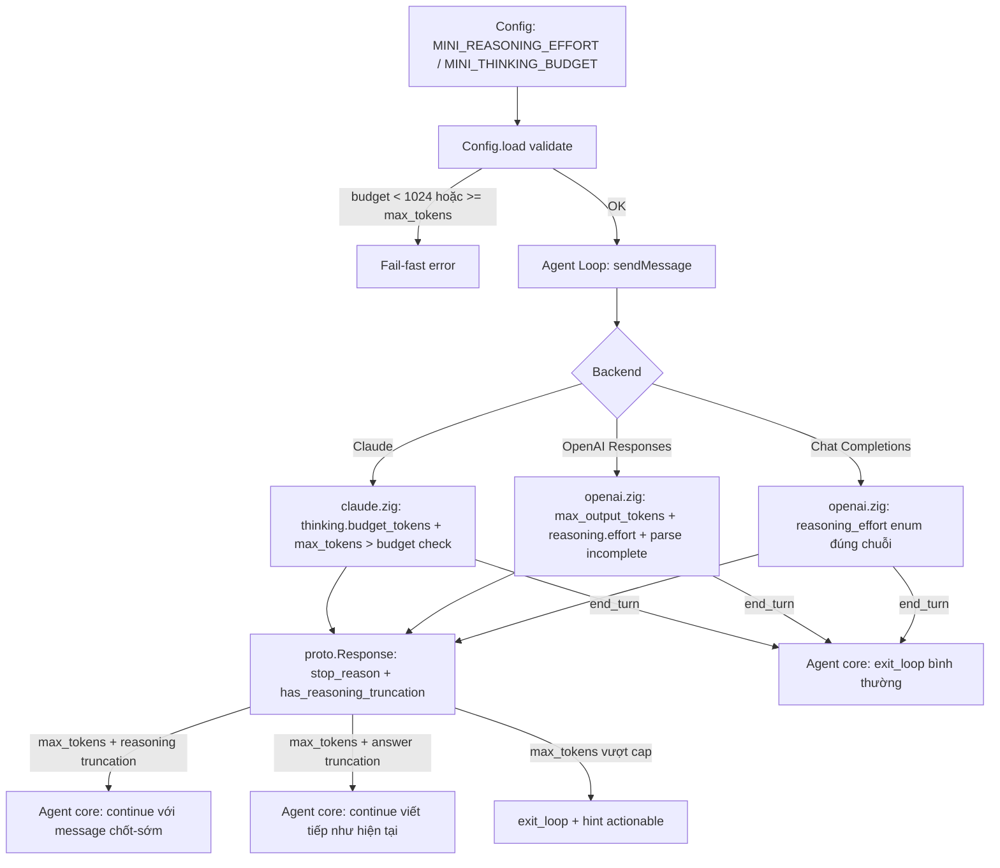

# RFC-009: Thinking Budget & Reasoning Effort Proposal — Quản lý Token Suy Luận khi Response bị cắt bởi max_tokens

> **Ngày:** 2026-09-03
> **Trạng thái:** Proposed
> **Tác giả:** mini-agent team
> **Mục tiêu:** Chuẩn hóa điều khiển **Thinking Budget** (Anthropic `thinking.budget_tokens`) và **Reasoning Effort** (OpenAI `reasoning.effort` / `reasoning_effort`), đồng thời khắc phục lỗi **bỏ sót response bị cắt giữa reasoning** (untracked truncation) — hiện tại chỉ `finish_reason: length` / `stop_reason: max_tokens` mới kích hoạt continue-loop.

---

## 1. Vấn đề hiện trạng (Problem Statement)

### 1.1. Anthropic Extended Thinking — có parse, không có request

Trong `src/backends/claude.zig`:
- Parser **đã hỗ trợ đầy đủ** `content_block_start(thinking)` / `thinking_delta` / `signature_delta` (dòng ~299-375) và message replay có `content: [{type:"thinking", ...}]`.
- Nhưng `buildRequestBody` chỉ emit `{"model":..., "max_tokens":..., "stream":true, ...}` — **không bao giờ gửi tham số `thinking`**, nên extended thinking không bao giờ được kích hoạt phía server. Tính năng nhận diện chết trong code.

### 1.2. OpenAI Responses API — không giới hạn, không phát hiện cắt

Trong `src/backends/openai.zig`:
- `buildResponsesRequestBody` thực hiện `_ = max_tokens;` (dòng ~295): **không gửi `max_output_tokens`** → server dùng default (thường rất lớn) hoặc từ chối.
- `reasoning.effort` được hardcode `"medium"`, không điều khiển được theo cấu hình người dùng.
- Parser bỏ qua event `response.incomplete` cũng như field `status:"incomplete"` / `incomplete_details.reason == "max_output_tokens"` của Responses API (dòng ~586) → response bị cắt giữa **reasoning** không set `stop_reason = .max_tokens` mà bị gán nhầm thành `.end_turn`. Điều này nguy hiểm vì với reasoning models, token bị cắt rơi vào **thinking** chứ không phải answer — user thấy spinner/TTFT chạy rồi response trống hoặc dừng đột ngột.

### 1.3. Chat Completions — thiếu điều khiển các cấp độ effort

Trong `src/backends/openai.zig`: `buildRequestBody` (dòng ~377) gửi `"reasoning_effort":"none"` khi disable (đúng chuẩn API để tắt suy luận), nhưng khi không disable lại **không gửi tham số `reasoning_effort` nào** (để server tự dùng mặc định) — không điều khiển được các cấp độ effort (`low`, `medium`, `high`) cho dòng model reasoning (o-series, GPT-5.x, DeepSeek-R1, Qwen3, ...).

### 1.4. Agent Core — continue vô hạn, không phân biệt nội dung bị cắt

`src/core/agent.zig` `switch (response.stop_reason)`:
- `.max_tokens` → tăng `max_tokens_continues`, chèn user message "[System] ... tiếp tục ĐÚNG từ chỗ dừng". Nhưng:
  - **Không có trần số lần continue** → risk vòng lặp vô hạn (burn credit, treo terminal) nếu server cứ trả `length` liên tục.
  - **Không phân biệt cắt giữa thinking vs answer**: message continue hiện tại sai ngữ nghĩa với reasoning models (bảo model "viết tiếp" khi thực ra thinking mới bị cắt, phần trả lời chưa bắt đầu).
  - Không track chi phí đã tiêu trong turn khi bị cắt liên tục (liên quan `budget_max_tokens` RFC-002).

---

## 2. Mục tiêu & Phi mục tiêu

### Mục tiêu
1. **Đơn điểm cấu hình**: `reasoning_effort` + `thinking_budget` cấu hình 1 lần (config.json / env), backend adapter tự dịch sang đúng wire-format từng provider.
2. **Bám sát khả năng có sẵn**: Claude parser đã sẵn sàng — chỉ cần hoàn thiện phía request; không đụng Agent Loop nếu không cần thiết.
3. **Phòng thủ vòng lặp vô hạn**: cap continue khi response bị cắt, phân biệt cắt-ở-thinking vs cắt-ở-answer.
4. **Tương thích ngược**: mặc định hành vi không đổi (không gửi thinking → như hiện tại), chỉ kích hoạt khi user cấu hình.

### Phi mục tiêu
- Không thay đổi Agent Loop / CodeAct protocol.
- Không tự động điều chỉnh budget theo loại task (chỉ expose config tĩnh + heuristic đơn giản).
- Không hỗ trợ streaming chi tiết token usage của reasoning (usage cơ bản vẫn parse như cũ).

---

## 3. Thiết kế chi tiết (Detailed Design)

### 3.1. Config layer (`src/core/config.zig`)

Thêm nhóm field mới:

```zig
/// Reasoning effort cho OpenAI-compatible: "minimal" | "low" | "medium" | "high" | null (=off).
reasoning_effort: ?[]const u8 = null,
/// Off-switch mềm, đặt true để ép không gửi reasoning params (backend compat).
reasoning_effort_disabled: bool = false,
/// Anthropic thinking budget (token). Null = không kích hoạt extended thinking.
thinking_budget_tokens: ?u32 = null,
/// Anthropic thinking temperature: chỉ cho phép 1.0 khi bật thinking (ràng buộc API).
thinking_temperature: f32 = 1.0,
/// Trần số lần auto-continue khi response bị cắt bởi max_tokens (mỗi turn).
max_tokens_continue_cap: usize = 3,
```

Env/config keys tương ứng: `MINI_REASONING_EFFORT`, `MINI_THINKING_BUDGET`, `MINI_MAX_TOKENS_CONTINUE_CAP`.

**Ràng buộc hợp lệ (validation ở Config.load):**
- `thinking_budget_tokens` phải **>= 1024** (Anthropic yêu cầu tối thiểu 1024) và **< max_tokens** (thinking budget phải nhỏ hơn max_tokens).
- `reasoning_effort` ∈ {minimal, low, medium, high} — chuỗi khác → lỗi config khi load (fail-fast).
- Khi `thinking_budget_tokens != null`, agent phải **loại bỏ temperature/top_p nếu user set giá trị khác 1.0** (Anthropic bắt buộc temperature=1 với extended thinking) — warn stderr và override.

### 3.2. Claude adapter (`src/backends/claude.zig`)

Đổi signature `buildRequestBody` nhận thêm `thinking_budget: ?u32`:

```json
{
  "model": "...",
  "max_tokens": 24000,
  "stream": true,
  "system": [...],
  "messages": [...], 
  "thinking": { "type": "enabled", "budget_tokens": 4096 }
}
```

- Chỉ thêm object `thinking` khi `thinking_budget != null` (tương thích ngược, server mặc định không bật).
- Lưu ý wire-format đúng chuẩn Anthropic Messages API cho các model dùng fixed budget (Claude 3.7): `thinking: { type: "enabled", budget_tokens: N }`, **kèm ràng buộc `max_tokens > budget_tokens`** (kiểm tra ở tầng client trước khi serialize, không đợi server 400).
- Với các model Anthropic thế hệ mới áp dụng **Adaptive Thinking** (như Claude Opus 4.7+, Sonnet 5), API yêu cầu `thinking: { type: "adaptive" }` kèm `output_config.effort` thay vì `budget_tokens` cố định (xem §6 Open Questions).
- Không đổi phần parse response — parser thinking_delta đã hỗ trợ đầy đủ.

### 3.3. OpenAI adapter (`src/backends/openai.zig`)

#### 3.3.1. Responses API (`buildResponsesRequestBody`)
- **Gửi `max_output_tokens`** thay vì bỏ qua: dùng giá trị `max_tokens` config + đệm cho reasoning: `max_output_tokens = max_tokens + thinking_budget_hint` (đảm bảo answer không bị ăn hết bởi reasoning).
- **`reasoning: { effort: <effort> }`** lấy từ config, không hardcode `"medium"`; `effort:"none"` chỉ dùng khi `reasoning_effort_disabled` hoặc effort = null.
- **Bắt event `event: response.incomplete` và parse `status == "incomplete"` / `incomplete_details.reason == "max_output_tokens"`** trong SSE stream handler ([openai.zig:586](file:///mnt/hdd/projects/persional/mini/src/backends/openai.zig#L586)) → set `stop_reason = .max_tokens` trong `StreamCtx` thay vì gán mặc định `.end_turn` — kích hoạt continue-loop hiện có của Agent Core.

#### 3.3.2. Chat Completions (`buildRequestBody`)
- `reasoning_effort` field emit đúng chuỗi effort từ config (minimal|low|medium|high), không phải chỉ "none".
- Khi `reasoning_effort_disabled` (hoặc model heuristic từ Issue-BACKEND-001 cho biết model không nhận effort cùng tools) → gửi `reasoning_effort:"none"` hoặc omit hoàn toàn (giữ nguyên logic auto-negotiation hiện có).

### 3.4. Agent core (`src/core/agent.zig`)

Refactor nhánh `.max_tokens` của `switch (response.stop_reason)`:

```zig
.max_tokens => {
    self.max_tokens_continues += 1;
    // (1) Trần continue: vượt cap → thoát loop thay vì loop vô hạn
    if (self.max_tokens_continues > self.config.max_tokens_continue_cap) {
        main.stderrPrint(
            "[agent] ✗ Đạt trần {d} lần auto-continue do max_tokens. " ++
            "Hãy tăng max_tokens / thinking_budget hoặc chia nhỏ tác vụ.\n", ...);
        return .exit_loop;
    }
    // (2) Phân biệt cắt-ở-thinking vs cắt-ở-answer
    if (response.has_reasoning_truncation) {
        // Chèn message chốt-sớm (xem 3.4.1)
    } else {
        // Giữ nguyên message "viết tiếp từ chỗ dừng" hiện có
    }
    return .continue_loop;
}
```

- Thêm field tạm `has_reasoning_truncation: bool` vào `proto.Response` (đặt true khi content cuối là thinking và stop_reason == max_tokens, hoặc Responses API incomplete_details).
- Note thứ tự content của Anthropic: thinking blocks đứng trước text/tool_use → kiểm tra content cuối cùng trước stop là đủ để phân loại.

#### 3.4.1. Message continue cho case thinking-truncation

```
[System] Phản hồi bị cắt trong pha suy luận (reasoning/thinking) do đạt giới hạn token.
Không lặp lại suy luận đã làm. Hãy chốt câu trả lời NGẮN GỌNG ngay bây giờ —
nếu khối ```js ... ``` hoặc tool call đang dở, viết tiếp để hoàn thành khối trước khi chốt.
```

### 3.5. Tương tác với auto-negotiation hiện có (Issue-BACKEND-001)

- `disable_reasoning_effort` (flag fallback khi HTTP 400 tools+effort) giữ nguyên ngữ nghĩa: nó chỉ tắt **effort string**, không tắt thinking budget của Claude (2 backend độc lập).
- Khi fallback đổi protocol, giữ nguyên `max_output_tokens`/`reasoning.effort` — chỉ đổi wire-format.
- Cache protocol memory (Tier 3) không thay đổi.

---

## 3.6. Wire-Format Matrix (tham khảo nhanh)

| Provider / Protocol | Param gửi đi | Khi off | Giá trị mặc định |
|---|---|---|---|
| **Claude (Fixed)** | `max_tokens` + `thinking.budget_tokens` | omit `thinking` | hiện không gửi `thinking` |
| **Claude (Adaptive)** | `max_tokens` + `thinking.type: "adaptive"` | omit `thinking` | hỗ trợ ở model Anthropic mới |
| **Claude / OpenAI CC** | `max_tokens` / `max_completion_tokens` | omit param | 24000 (`MINI_MAX_TOKENS` default) |
| **OpenAI Responses** | `max_output_tokens` + `reasoning.effort` | omit `reasoning` | effort=medium (hiện hardcode), max_output_tokens=max_tokens+budget_hint |
| **OpenAI Chat Completions** | `reasoning_effort` | `"none"` khi disabled | omit (dùng default server) |

---

## 3.7. Kiến trúc luồng (Architecture Flow)



---

## 4. Kế hoạch triển khai (Implementation Plan)

### Phase 1 — Config & Claude thinking (chưa đụng Agent Loop)
1. `config.zig`: thêm 5 field + validation + env parse.
2. `claude.zig`: `buildRequestBody` nhận `thinking_budget: ?u32`, emit object `thinking` khi Some, check `max_tokens > budget`.
3. Unit test: `testcases/test_rfc009_thinking_budget.zig` — kiểm tra JSON body chứa/ không chứa `thinking`, ràng buộc min 1024.

### Phase 2 — OpenAI effort + incomplete detection
4. `openai.zig`: Responses body gửi `max_output_tokens` + `reasoning.effort` từ config; Chat Completions gửi effort string đúng.
5. Parser map `status:"incomplete"` / `incomplete_details` → `.max_tokens`.
6. Unit test: mock SSE với status incomplete → assert stop_reason == .max_tokens.

### Phase 3 — Agent core truncation-aware continue
7. `protocol.zig`: thêm `has_reasoning_truncation: bool = false`.
8. `agent.zig`: cap `max_tokens_continues` (mặc định 3), phân nhánh message theo truncation type, exit với hint khi vượt cap.
9. Test tầng 3 (E2E): mock SSE liên tục trả `length` → assert dừng sau cap lần, không treo.

### Phase 4 — Docs
10. Update `docs/agent_loop_execution_architecture.md` mục stop-reason handling; thêm ví dụ cấu hình vào README section cấu hình reasoning.

---

## 5. Rủi ro & Giảm thiểu (Risks & Mitigations)

| Rủi ro | Mức | Giảm thiểu |
|---|---|---|
| Chi phí tăng khi effort=high + budget lớn | Trung bình | Journal exec_type đã ghi log mỗi act; có thể đọc `usage.reasoning_tokens` để auto-backoff (để phase sau). |
| max_tokens nhỏ hơn budget+answer → cắt liên tục | Trung bình | Preflight check client-side: nếu `max_tokens <= budget + 512` → warn ngay khi load config. |
| OpenAI-compat provider không nhận `reasoning_effort` (HTTP 400) | Trung bình | Tận dụng auto-negotiation disable_reasoning_effort có sẵn, mở rộng điều kiện lỗi string "reasoning_effort". |
| Temperature != 1.0 cùng thinking budget (Anthropic 400) | Thấp | Override về 1.0 + warn stderr; không để server 400. |
| Config sai giá trị effort string | Thấp | Fail-fast ở Config.load, không đợi HTTP 400. |
| Continue-loop vô hạn | Cao | Cap `max_tokens_continues` (mặc định 3) + journal exec_type="max_tokens" đã có sẵn để audit. |

---

## 6. Câu hỏi mở (Open Questions)

1. **Hỗ trợ Adaptive Thinking của Anthropic**: Các model Claude mới (Opus 4.7+, Sonnet 5) chuyển sang `thinking: { "type": "adaptive" }` kèm `output_config.effort` thay vì `budget_tokens` (nếu gửi `budget_tokens` sẽ bị HTTP 400). Có nên cho phép `thinking_budget_tokens: 0` hoặc chuỗi `"adaptive"` để tự động kích hoạt mode này? *(Đề xuất: hỗ trợ enum/mode `adaptive` ở Phase 1.5 khi tích hợp các model mới.)*
2. Có nên map `reasoning_effort: minimal` → Anthropic `thinking budget ≈ 2048` (cross-provider mapping)? Hay giữ 2 cấu hình độc lập hoàn toàn? *(Đề xuất: giữ độc lập, không mapping magic — tránh hành vi bất ngờ.)*
3. Có cần expose `/config` command trong REPL để xem/đổi effort mid-session không? *(Đề xuất: để RFC sau, ưu tiên correctness trước convenience.)*
4. `max_output_tokens` Responses API có nên cộng thêm đệm riêng cho reasoning không, hay trust server-side default? *(Đề xuất: cộng thêm `thinking_budget_hint` = 0 khi effort off, = 2^k×1024 theo effort khi on.)*
5. Có cần telemetry riêng đếm reasoning token (usage.output_tokens_details.reasoning_tokens) cho cost report? *(Đề xuất: parse + log vào journal exec_type, chưa expose UI.)*

---

## 7. Checklist theo dõi (Tracking Checklist)

- [ ] Phase 1: Config fields + validation + env keys
- [ ] Phase 1: Claude thinking.budget_tokens emit + client-side preflight
- [ ] Phase 2: OpenAI Responses max_output_tokens + effort từ config
- [ ] Phase 2: Parser map incomplete → .max_tokens
- [ ] Phase 3: `proto.Response` thêm `has_reasoning_truncation` + truncation-aware continue
- [ ] Phase 3: Continue-loop cap + reasoning-truncation-aware message
- [ ] Phase 3: E2E mock test: liên tục length → dừng đúng cap
- [ ] Phase 4: Docs update (agent_loop doc + README config section)

---

## 8. Tài liệu tham chiếu

- `docs/issue_openai_responses_api_auto_negotiation.md` — Dual-Protocol Auto-Negotiation (context `disable_reasoning_effort`).
- `docs/rfc_002_long_horizon_event_sourcing_proposal.md` — budget_max_tokens & journaling exec_type.
- `docs/rfc_003_memact_context_memory_proposal.md` — token budget pattern (memact_memory_budget).
- Anthropic Docs: Extended thinking (thinking.budget_tokens ≥ 1024, temperature=1.0 ràng buộc).
- OpenAI Docs: Responses API `reasoning.effort` ∈ {minimal, low, medium, high}, `max_output_tokens`, `incomplete_details.reason`.
- OpenAI Docs: Chat Completions `reasoning_effort` (mặc định medium, o-series yêu cầu max_completion_tokens).